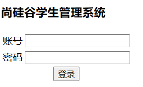
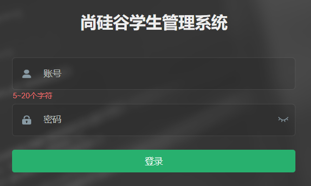
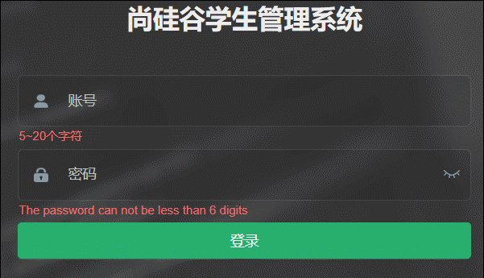
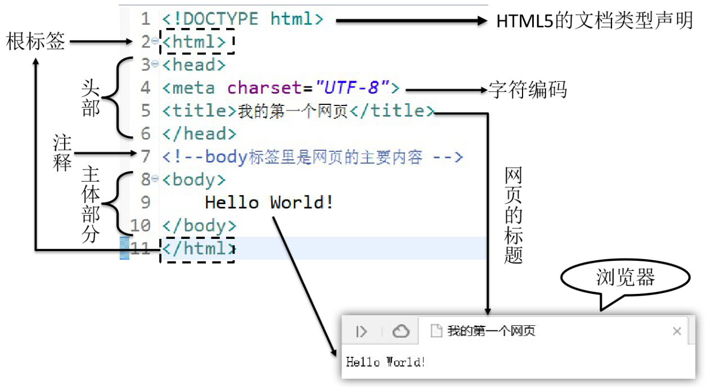
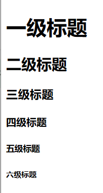

# 第二章 HTML&CSS

# 一 HTML入门

IDEA 快捷输入：

! + Tab：快速生成 HTML5 基本结构

c + Tab：快速生成 HTML 注释

## 1.1 HTML&CSS&JavaScript的作用

> HTML 主要用于网页主体结构的搭建



> CSS 主要用于页面元素美化



> JavaScript 主要用于页面元素的动态处理



## 1.2 什么是HTML

> HTML是Hyper Text Markup Language的缩写。意思是超文本标记语言。它的作用是搭建网页结构，在网页上展示内容

HTML5 是 HyperText Markup Language 5 的缩写，HTML5 技术结合了 HTML4.01 的相关标准并革新，符合现代网络发展要求，在 2008 年正式发布。HTML5 由不同的技术构成，其在互联网中得到了非常广泛的应用，提供更多增强网络应用的标准机。与传统的技术相比，HTML5 的语法特征更加明显，并且结合了 SVG 的内容。这些内容在网页中使用可以更加便捷地处理多媒体内容，而且 HTML5 中还结合了其他元素，对原有的功能进行调整和修改，进行标准化工作。HTML5 在 2012 年已形成了稳定的版本。2014 年 10 月 28 日，W3C 发布了 HTML5 的最终版。

## 1.3 什么是超文本

> HTML文件本质上是文本文件，而普通的文本文件只能显示字符。但是HTML技术则通过HTML标签把其他网页、图片、音频、视频等各种多媒体资源引入到当前网页中，让网页有了非常丰富的呈现方式，这就是超文本的含义——本身是文本，但是呈现出来的最终效果超越了文本。

## 1.4 什么是标记语言

> 说HTML是一种『标记语言』是因为它不是像Java这样的『编程语言』，因为它是由一系列『标签』组成的，没有常量、变量、流程控制、异常处理、IO等等这些功能。HTML很简单，每个标签都有它固定的含义和确定的页面显示效果。

- 双标签:标签是通过一组尖括号+标签名的方式来定义的：

```html
<p>HTML is a very popular fore-end technology.</p>
```

这个例子中使用了一个p标签来定义一个段落，\<p>叫**开始标签**，\</p>叫**结束标签**。开始标签和结束标签一起构成了一个完整的标签。开始标签和结束标签之间的部分叫
**文本标签体**，也简称：**标签体**。

- 单标签

```html
<input type="text" name="username"/>
```

- 属性

```html
<a href="http://www.xxx.com">show detail</a>
```

href="网址" 就是属性，href是属性名，"网址"是属性值

## 1.5 HTML基础结构

> 1 文档声明

+ HTML文件中第一行的内容，用来告诉浏览器当前HTML文档的基本信息，其中最重要的就是当前HTML文档遵循的语法标准。这里我们只需要知道HTML有4和5这两个大的版本
+ HTML4版本的文档类型声明是：

```HTML
<!DOCTYPE HTML PUBLIC "-//W3C//DTD HTML 4.01 Transitional//EN"
  "http://www.w3.org/TR/html4/loose.dtd">
```

+ HTML5版本的文档类型声明是：

``` html
<!DOCTYPE html>
```

+ 现在主流的技术选型都是使用HTML5，之前的版本基本不用了。

> 2根标签

+ html标签是整个文档的根标签，所有其他标签都必须放在html标签里面。

> 3头部元素

+ head标签用于定义文档的头部，其他头部元素都放在head标签里。头部元素包括title标签、script标签、style标签、link标签、meta标签等等。

> 4主体元素

+ body标签定义网页的主体内容，在浏览器窗口内显示的内容都定义到body标签内。

> 5注释

+ HTML注释的写法是

``` html
<!-- 注释内容 -->
```



## 1.6 HTML的入门程序

+ 在html中,输入"  !  " 并回车即可快速出现html的基本结构

+ 代码：[first-page.html](../src/main/java/com/example/phase1/first-page.html)

## 1.7 HTML概念词汇解释

> 标签

+ 代码中的一个 <> 叫做一个标签,有些标签成对出现,称之为双标签,有些标签单独出现,称之为单标签

> 属性

+ 一般在开始标签中,用于定义标签的一些特征

> 文本

+ 双标签中间的文字,包含空格换行等结构

> 元素

+ 经过浏览器解析后,每一个完整的标签(标签+属性+文本)可以称之为一个元素

## 1.8 HTML的语法规则

+ 1 根标签有且只能有一个

+ 2 无论是双标签还是单标签都需要正确关闭

+ 3 标签可以嵌套但不能交叉嵌套

+ 4 注释语法为<!-- -->  ,注意不能嵌套

+ 5 属性必须有值，值必须加引号,H5中属性名和值相同时可以省略属性值

+ 6 HTML中不严格区分字符串使用单双引号

+ 7 HTML标签不严格区分大小写,但是不能大小写混用

+ 8 HTML中不允许自定义标签名,强行自定义则无效

# 二 HTML常见标签

示例代码：

[2.1–2.3 标题、段落与换行标签](../src/main/java/com/example/phase1/heading-paragraph-line-break.html)

[2.4 列表标签](../src/main/java/com/example/phase1/ordered-unordered-lists.html)

## 2.1 标题标签

> 标题标签一般用于在页面上定义一些标题性的内容,如新闻标题,文章标题等,有h1到h6六级标题

+ 效果



## 2.2 段落标签

> 段落标签一般用于定义一些在页面上要显示的大段文字,多个段落标签之间实现自动分段的效果

## 2.3 换行标签

> 单纯实现换行的标签是br,如果想添加分隔线,可以使用hr标签

## 2.4 列表标签

> 有序列表 分条列项展示数据的标签, 其每一项前面的符号带有顺序特征
> 
> 无序列表 分条列项展示数据的标签, 其每一项前面的符号不带有顺序特征
> 
> 嵌套列表 列表和列表之间可以嵌套,实现某一项内容详细展示
