# 第二章 HTML&CSS

# 一 HTML入门

IDEA 快捷输入：

! + Tab：快速生成 HTML5 基本结构

c + Tab：快速生成 HTML 注释

## 1.1 HTML&CSS&JavaScript的作用

> HTML 主要用于网页主体结构的搭建

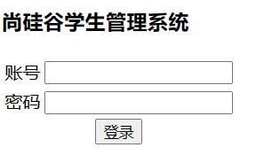

> CSS 主要用于页面元素美化

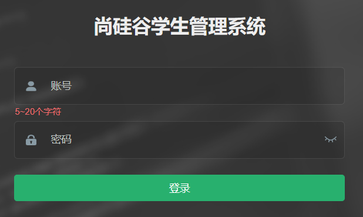

> JavaScript 主要用于页面元素的动态处理

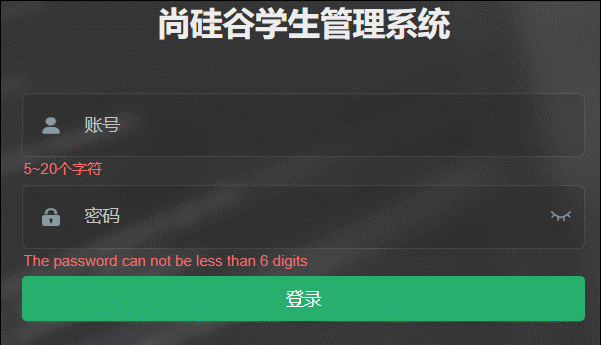

## 1.2 什么是HTML

> HTML是Hyper Text Markup Language的缩写。意思是超文本标记语言。它的作用是搭建网页结构，在网页上展示内容

HTML5 是 HyperText Markup Language 5 的缩写，HTML5 技术结合了 HTML4.01 的相关标准并革新，符合现代网络发展要求，在 2008 年正式发布。HTML5 由不同的技术构成，其在互联网中得到了非常广泛的应用，提供更多增强网络应用的标准机。与传统的技术相比，HTML5 的语法特征更加明显，并且结合了 SVG 的内容。这些内容在网页中使用可以更加便捷地处理多媒体内容，而且 HTML5 中还结合了其他元素，对原有的功能进行调整和修改，进行标准化工作。HTML5 在 2012 年已形成了稳定的版本。2014 年 10 月 28 日，W3C 发布了 HTML5 的最终版。

## 1.3 什么是超文本

> HTML文件本质上是文本文件，而普通的文本文件只能显示字符。但是HTML技术则通过HTML标签把其他网页、图片、音频、视频等各种多媒体资源引入到当前网页中，让网页有了非常丰富的呈现方式，这就是超文本的含义——本身是文本，但是呈现出来的最终效果超越了文本。

## 1.4 什么是标记语言

> 说HTML是一种『标记语言』是因为它不是像Java这样的『编程语言』，因为它是由一系列『标签』组成的，没有常量、变量、流程控制、异常处理、IO等等这些功能。HTML很简单，每个标签都有它固定的含义和确定的页面显示效果。

- 双标签:标签是通过一组尖括号+标签名的方式来定义的：

```html
<p>HTML is a very popular fore-end technology.</p>
```

这个例子中使用了一个p标签来定义一个段落，\<p>叫**开始标签**，\</p>叫**结束标签**。开始标签和结束标签一起构成了一个完整的标签。开始标签和结束标签之间的部分叫
**文本标签体**，也简称：**标签体**。

- 单标签

```html
<input type="text"
       name="username"/>
```

- 属性

```html
<a href="http://www.xxx.com">show detail</a>
```

href="网址" 就是属性，href是属性名，"网址"是属性值

## 1.5 HTML基础结构

> 1 文档声明

+ HTML文件中第一行的内容，用来告诉浏览器当前HTML文档的基本信息，其中最重要的就是当前HTML文档遵循的语法标准。这里我们只需要知道HTML有4和5这两个大的版本
+ HTML4版本的文档类型声明是：

```HTML
<!DOCTYPE HTML PUBLIC "-//W3C//DTD HTML 4.01 Transitional//EN"
  "http://www.w3.org/TR/html4/loose.dtd">
```

+ HTML5版本的文档类型声明是：

``` html
<!DOCTYPE html>
```

+ 现在主流的技术选型都是使用HTML5，之前的版本基本不用了。

> 2根标签

+ html标签是整个文档的根标签，所有其他标签都必须放在html标签里面。

> 3头部元素

+ head标签用于定义文档的头部，其他头部元素都放在head标签里。头部元素包括title标签、script标签、style标签、link标签、meta标签等等。

> 4主体元素

+ body标签定义网页的主体内容，在浏览器窗口内显示的内容都定义到body标签内。

> 5注释

+ HTML注释的写法是

``` html
<!-- 注释内容 -->
```

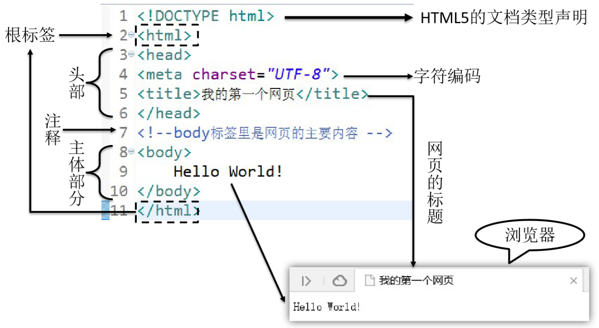

## 1.6 HTML的入门程序

+ 在html中,输入"  !  " 并回车即可快速出现html的基本结构

+ 代码：[first-page.html](../src/main/java/com/example/phase1/first-page.html)

## 1.7 HTML概念词汇解释

> 标签

+ 代码中的一个 <> 叫做一个标签,有些标签成对出现,称之为双标签,有些标签单独出现,称之为单标签

> 属性

+ 一般在开始标签中,用于定义标签的一些特征

> 文本

+ 双标签中间的文字,包含空格换行等结构

> 元素

+ 经过浏览器解析后,每一个完整的标签(标签+属性+文本)可以称之为一个元素

## 1.8 HTML的语法规则

+ 1 根标签有且只能有一个

+ 2 无论是双标签还是单标签都需要正确关闭

+ 3 标签可以嵌套但不能交叉嵌套

+ 4 注释语法为<!-- -->  ,注意不能嵌套

+ 5 属性必须有值，值必须加引号,H5中属性名和值相同时可以省略属性值

+ 6 HTML中不严格区分字符串使用单双引号

+ 7 HTML标签不严格区分大小写,但是不能大小写混用

+ 8 HTML中不允许自定义标签名,强行自定义则无效

# 二 HTML常见标签

示例代码：

[2.1–2.3 标题、段落与换行标签](../src/main/java/com/example/phase1/heading-paragraph-line-break.html)

[2.4 列表标签](../src/main/java/com/example/phase1/ordered-unordered-lists.html)

## 2.1 标题标签

> 标题标签一般用于在页面上定义一些标题性的内容,如新闻标题,文章标题等,有h1到h6六级标题

+ 效果

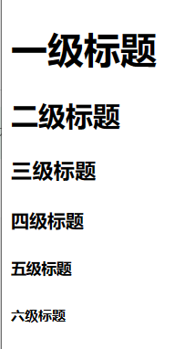

## 2.2 段落标签

> 段落标签一般用于定义一些在页面上要显示的大段文字,多个段落标签之间实现自动分段的效果

## 2.3 换行标签

> 单纯实现换行的标签是br,如果想添加分隔线,可以使用hr标签

## 2.4 列表标签

> 有序列表 分条列项展示数据的标签, 其每一项前面的符号带有顺序特征
>
> 无序列表 分条列项展示数据的标签, 其每一项前面的符号不带有顺序特征
>
> 嵌套列表 列表和列表之间可以嵌套,实现某一项内容详细展示

## 2.5 超链接标签

> 点击后带有链接跳转的标签 ,也叫作a标签

+ href属性用于定义连接
    + href中可以使用绝对路径,以/开头,始终以一个固定路径作为基准路径作为出发点
    + href中也可以使用相对路径,不以/开头,以当前文件所在路径为出发点
    + href中也可以定义完整的URL

+ target用于定义打开的方式
    + _blank 在新窗口中打开目标资源
    + _self 在当前窗口中打开目标资源

示例代码：

[超链接标签](../src/main/java/com/example/phase1/hyperlinks.html)

[test.html](../src/main/java/com/example/phase1/pages/test.html)

[test2.html](../src/main/java/com/example/phase1/pages/a/test2.html)

## 2.6 多媒体标签

> img(重点) 图片标签,用于在页面上引入图片
>
> 示例代码：[图片标签示例](../src/main/java/com/example/phase1/images.html)

> audio 用于在页面上引入一段声音
>
> video 用于在页面上引入一段视频
>
> 示例代码：[音频和视频标签示例](../src/main/java/com/example/phase1/multimedia.html)

## 2.7 表格标签（重点）

> 常规表格

+ 使用 `table`、`tr`、`th`、`td` 等标签构建表格。

> 单元格跨行

+ 通过单元格的 `rowspan` 属性实现上下跨行。

> 单元格跨列

+ 通过单元格的 `colspan` 属性实现左右跨列。

> 示例代码：[表格标签示例](../src/main/java/com/example/phase1/tables.html)

## 2.8 表单标签（重点）

> form 表单标签，用于让用户在页面上输入各种信息并提交，是向服务端发送数据的主要方式之一。

## 2.9 常见表单项标签（重点）

> 常见表单项：单行文本框、密码框、单选框、复选框、下拉框、按钮、隐藏域、多行文本框、文件选择框。

示例代码：

+ [表单标签及常见表单项示例（form.html）](../src/main/java/com/example/phase1/form.html)

+ [表单提交后的目标页面（welcome.html）](../src/main/java/com/example/phase1/welcome.html)

## 2.10 布局相关标签

> div标签  俗称"块",主要用于划分页面结构,做页面布局
>
> span标签 俗称"层",主要用于划分元素范围,配合CSS做页面元素样式的修饰
>
> 示例代码：[页面布局示例](../src/main/java/com/example/phase1/layout.html)

## 2.11 特殊字符

> 对于有特殊含义的字符,需要通过转移字符来表示

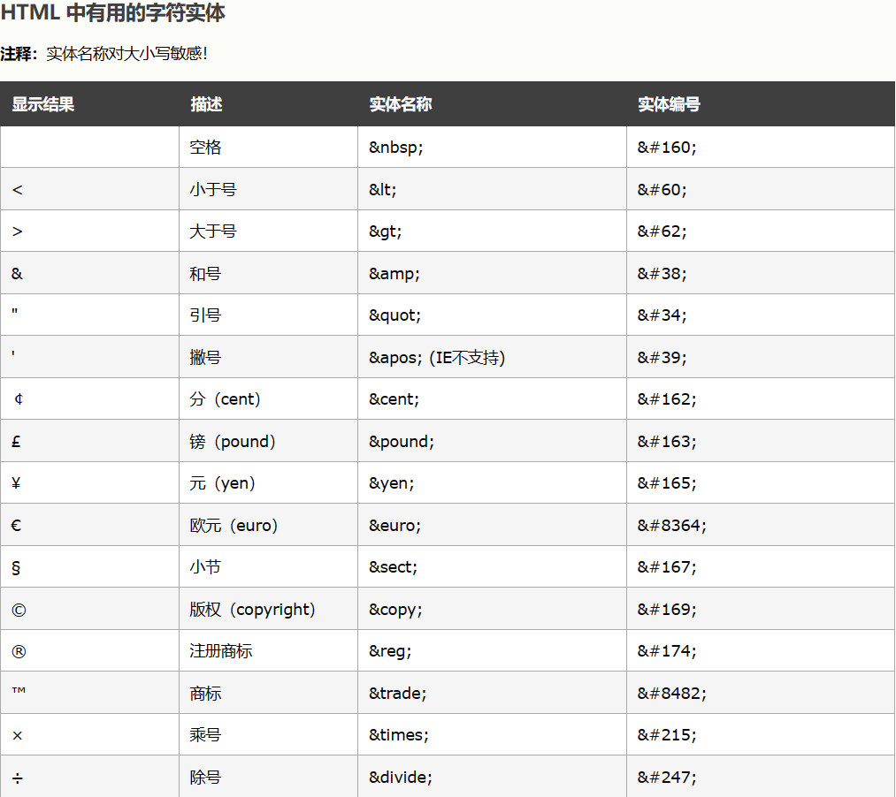

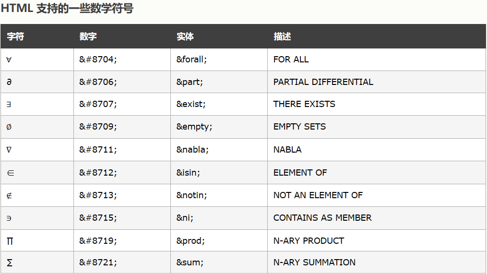

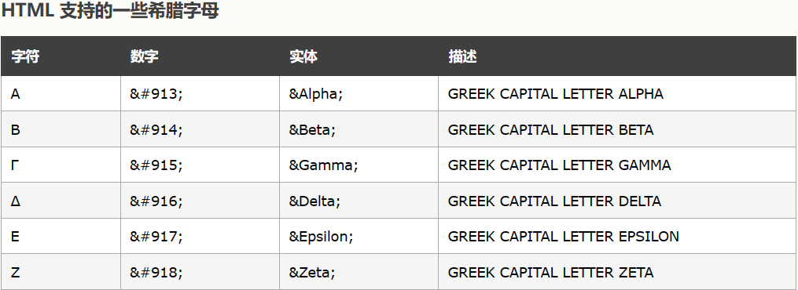

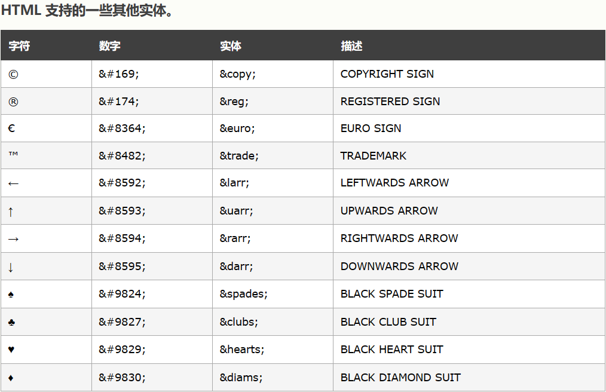

示例代码：[特殊字符示例](../src/main/java/com/example/phase1/special-characters.html)

# 三、CSS的使用

> CSS  层叠样式表（英文全称：Cascading Style Sheets）能够对网页中元素位置的排版进行像素级精确控制，支持几乎所有的字体字号样式，拥有对网页对象和模型样式编辑的能力 ,简单来说,美化页面

## 3.1 CSS 引入方式

- 行内式：通过元素的 `style` 属性引入。
- 内嵌式：在 HTML 的 `head` 中通过 `style` 标签定义。
- 外部样式表：将 CSS 单独放入 `.css` 文件，通过 `link` 标签引入。

示例代码：

- [CSS 引入方式示例](../src/main/java/com/example/phase2/css-inclusion-methods.html)
- [button.css](../src/main/java/com/example/phase2/css/button.css)

## 3.2 CSS选择器

> 常见选择器：元素选择器、ID 选择器、class 选择器。

- [CSS 选择器示例](../src/main/java/com/example/phase2/css-selectors.html)

## 3.3 CSS浮动

> CSS 的 Float（浮动）使元素脱离文档流，按照指定的方向（左或右）移动，直到它的外边缘碰到包含框或另一个浮动框的边框为止。

+ 设计初衷：解决文字环绕图片问题，浮动不会挡住文字。
+ 文档流：对象排列时占用的位置或空间；脱离文档流就是在页面中不占位置。

> 浮动原理

+ 向右浮动：脱离文档流并右移，直到右边缘碰到包含框的右边缘。
+ 当把框 1 向右浮动时，它脱离文档流并且向右移动，直到它的右边缘碰到包含框的右边缘

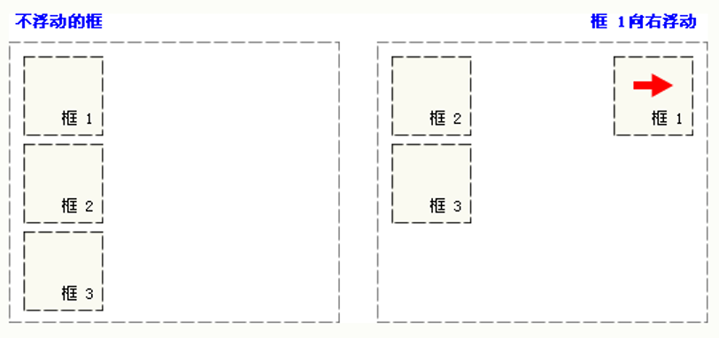

+ 向左浮动：脱离文档流并左移，因为不占位，会覆盖住后面的框2，使框2看不见；三个框都向左浮动时，依次贴靠包含框或前一个浮动框。
+ 当框 1 向左浮动时，它脱离文档流并且向左移动，直到它的左边缘碰到包含框的左边缘。因为它不再处于文档流中，所以它不占据空间，实际上覆盖住了框 2，使框 2 从视图中消失。如果把所有三个框都向左移动，那么框 1 向左浮动直到碰到包含框，另外两个框向左浮动直到碰到前一个浮动框。

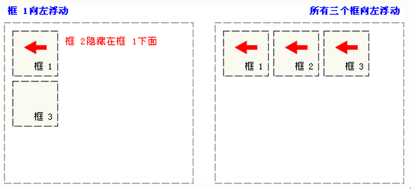

+ 包含框太窄放不下时，后面的浮动块会向下移动；浮动元素高度不同时，下移时可能被其他浮动元素卡住。
+ 如果包含框太窄，无法容纳水平排列的三个浮动元素，那么其它浮动块向下移动，直到有足够的空间。如果浮动元素的高度不同，那么当它们向下移动时可能被其它浮动元素“卡住”

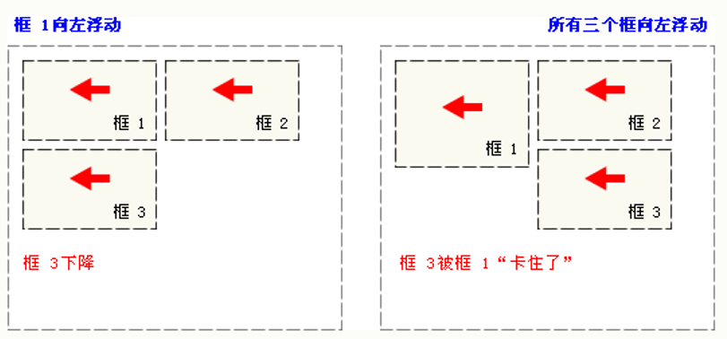

> 浮动的样式名:float

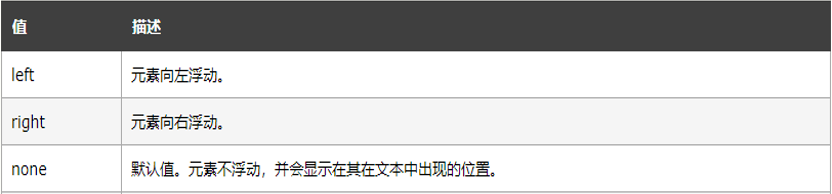

> 通过代码感受浮动的效果：[示例代码](../src/main/java/com/example/phase2/css-float.html)

## 3.4 CSS定位

`position` 属性用于指定元素的定位方式。

常见取值：

- `static`：静态定位（默认值）
- `relative`：相对定位
- `absolute`：绝对定位
- `fixed`：固定定位
- `sticky`：粘性定位

示例代码：[定位示例](../src/main/java/com/example/phase2/css-positioning.html)

## 3.5 CSS盒子模型

> 所有HTML元素可以看作盒子，在CSS中，"box model"这一术语是用来设计和布局时使用。

- 由内到外：content（内容）→ padding（内边距）→ border（边框）→ margin（外边距）

+ 说明：
    + Margin(外边距) - 清除边框外的区域，外边距是透明的。
    + Border(边框) - 围绕在内边距和内容外的边框。
    + Padding(内边距) - 清除内容周围的区域，内边距是透明的。
    + Content(内容) - 盒子的内容，显示文本和图像。

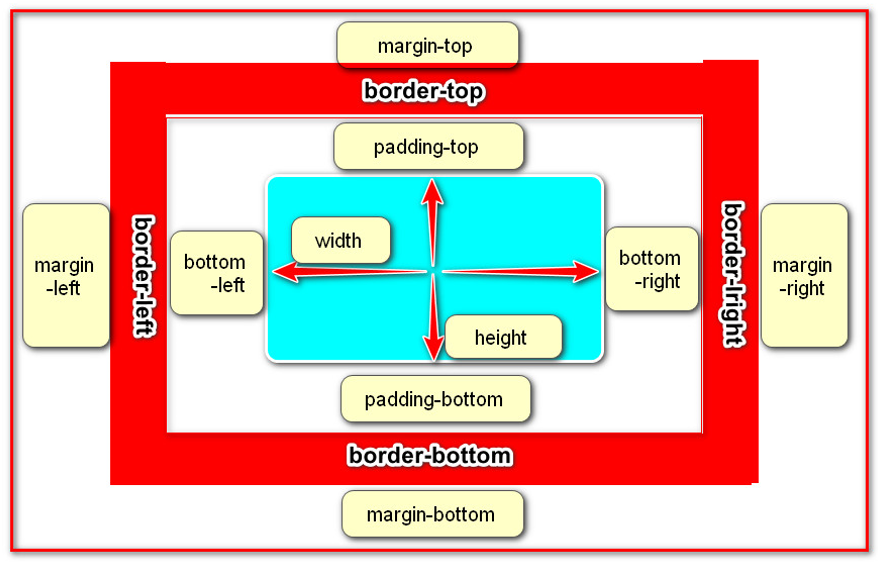

示例代码：[盒子模型](../src/main/java/com/example/phase2/css-box-model.html)
