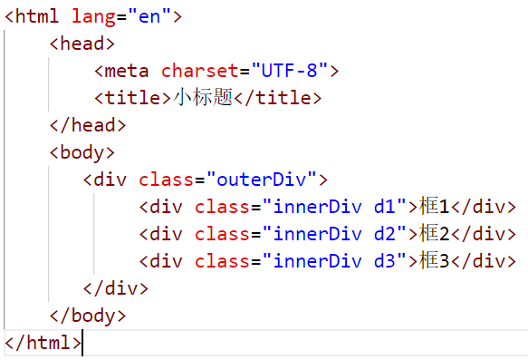
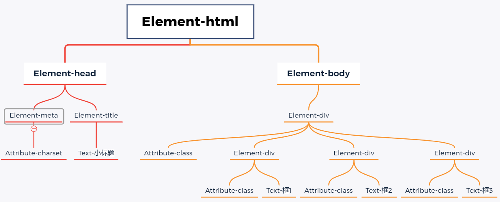

# 第三章 JavaScript

# 一 JS简介

## 1.1 JS起源

> Javascript是一种由Netscape(网景)的LiveScript发展而来的原型化继承的面向对象的动态类型的区分大小写的
`客户端脚本语言`，主要目的是为了解决服务器端语言，遗留的速度问题，为客户提供更流畅的浏览效果。当时服务端需要对数据进行验证，由于网络速度相当缓慢,只有28.8kbps，验证步骤浪费的时间太多。于是Netscape的浏览器Navigator加入了Javascript，提供了数据验证的基本功能。ECMA-262 是正式的 JavaScript 标准。这个标准基于 JavaScript (Netscape) 和 JScript (Microsoft)。ECMA-262 的开发始于 1996 年，在 1997 年 7 月，ECMA 会员大会采纳了它的首个版本。这个标准由 ECMA 组织发展和维护。JavaScript 的正式名称是 "ECMAScript"。JavaScript的组成包含ECMAScript、DOM、BOM。JS是一种运行于浏览器端上的小脚本语句,可以实现网页如文本内容、数据动态变化和动画特效等,JS有 如下特点

+ 脚本语言
    + JavaScript是一种解释型的脚本语言。不同于C、C++、Java等语言先编译后执行, JavaScript不会产生编译出来的字节码文件，而是在程序的运行过程中对源文件逐行进行解释。

+ 基于对象
    + JavaScript是一种基于对象的脚本语言，它不仅可以创建对象，也能使用现有的对象。但是面向对象的三大特性：『封装』、『继承』、『多态』中，JavaScript能够实现封装，可以模拟继承，不支持多态，所以它不是一门面向对象的编程语言。
+ 弱类型
    + JavaScript中也有明确的数据类型，但是声明一个变量后它可以接收任何类型的数据，并且会在程序执行过程中根据上下文自动转换类型。
+ 事件驱动
    + JavaScript是一种采用事件驱动的脚本语言，它不需要经过Web服务器就可以对用户的输入做出响应。
+ 跨平台性
    + JavaScript脚本语言不依赖于操作系统，仅需要浏览器的支持。因此一个JavaScript脚本在编写后可以带到任意机器上使用，前提是机器上的浏览器支持JavaScript脚本语言。目前JavaScript已被大多数的浏览器所支持。

## 1.2 JS 组成部分

> ECMA 及版本变化

+ 是一种由欧洲计算机制造商协会（ECMA）通过ECMA-262标准化的脚本程序语言,ECMAScript描述了语法、类型、语句、关键字、保留字、运算符和对象。它就是定义了脚本语言的所有属性、方法和对象。

+ ECMA-262第1版本质上跟网景的JavaScript 1.1相同，删除了浏览器特定代码和少量细微的修改.ECMA-262要求支持Unicode标准（以支持多语言）且对象要与平台无关
+ ECMA-262第2版只是做了一些编校工作，主要是为了严格符合ISO/IEC-16262的要求，并没有增减或改变任何特性。

+ ECMA-262第3版第一次真正对ECMAScript进行更新，更新了字符串处理、错误定义和数值输出，增加了对正则表达式、新的控制语句、try/catch异常处理的支持。
+ ECMA-262第4版是对这门语言的一次彻底修订。开发者开始修订ECMAScript以满足全球Web开发日益增长的需求。 第4版包括强类型变量、新语句和数据结构、真正的类和经典的继承，以及操作数据的新手段。
+ ECMA-262第5版是ECMA-262第3版的小幅改进，于2009年12月3日正式发布。第5版致力于厘清第3版存在的歧义，也增加了新功能。新功能包括原生的解析和序列化JSON数据的JSON对象、方便继承和高级属性定义的方法、新的增强ECMAScript引擎解释和执行代码能力的严格模式。
+ ECMA-262第6版俗称ES6、ES2015或ES Harmony（和谐版），于2015年6月发布。**
  `这一版包含了大概这个规范有史以来最重要的一批增强特性。`**ES6正式支持了类、模块、迭代器、生成器、箭头函数、期约、反射、代理和众多新的数据类型。但是并不是所有的浏览器都全面支持了ES6,很多情况下我们需要将ES6的语法通过工具转换成5以后运行
+ ECMA-262第7版也称为ES7或ES2016，于2016年6月发布。这次修订只包含少量语法层面的增强，如Array.prototype.includes和指数操作符。
+ ECMA-262第8版也称为ES8、ES2017，完成于2017年6月。这一版主要增加了异步函数（async/await）、SharedArrayBuffer及Atomics API、Object.values()/Object.entries()/Object.getOwnProperty- Descriptors()和字符串填充方法，另外明确支持对象字面量最后的逗号。
+ ECMA-262第9版也称为ES9、ES2018，发布于2018年6月。这次修订包括异步迭代、剩余和扩展属性、一组新的正则表达式特性、Promise finally()以及模板字面量修订。
+ ECMA-262第10版也称为ES10、ES2019，发布于2019年6月。这次修订增加了Array.prototype.flat()/flatMap()、String.prototype.trimStart()/trimEnd()、Object.fromEntries()方法以及Symbol.prototype.description属性，明确定义了Function.prototype.toString()的返回值并固定了Array.prototype.sort()的顺序。另外，这次修订解决了与JSON字符串兼容的问题，并定义了catch子句的可选绑定。
+ ECMA-262第11版，也成为ES11、ES2020，发布于2020年6月。这次修订增加了String 的 matchAll 方法、动态导入语句 import()、import.meta、export * as ns from 'module'、Promise.allSettled、GlobalThis、Nullish coalescing Operator、Optional Chaining以及一种新的数据类型BigInt，在此之后JavaScript正式迎来第8位数据类型。

> BOM编程

+ BOM是Browser Object Model的简写，即浏览器对象模型。

+ BOM有一系列对象组成，是访问、控制、修改浏览器的属性和方法

+ BOM没有统一的标准(每种客户端都可以自定标准)。

+ BOM编程是将浏览器窗口的各个组成部分抽象成各个对象,通过各个对象的API操作组件行为的一种编程

+ BOM编程的对象结构如下

    + window 顶级对象,代表整个浏览器窗口
        + location对象 window对象的属性之一,代表浏览器的地址栏
        + history对象 window对象的属性之一,代表浏览器的访问历史
        + screen对象 window对象的属性之一,代表屏幕
        + navigator对象 window对象的属性之一,代表浏览器软件本身
        + document对象 window对象的属性之一,代表浏览器窗口目前解析的html文档

    

> DOM编程

+ 简单来说:DOM编程就是使用document对象的API完成对网页HTML文档进行动态修改,以实现网页数据和样式动态变化效果的编程.
+ document对象代表整个html文档，可用来访问页面中的所有元素，是最复杂的一个dom对象，可以说是学习好dom编程的关键所在。
+ 根据HTML代码结构特点,document对象本身是一种树形结构的文档对象。

+ 上面的代码生成的树如下

+ DOM编程其实就是用window对象的document属性的相关API完成对页面元素的控制的编程

## 1.3 JS的引入方式

> 内部脚本方式引入
>
> 外部脚本方式引入

**代码示例**

- HTML 示例：[js-inclusion-methods.html](../src/main/java/com/example/phase3/js-inclusion-methods.html)
- JavaScript 示例：[button.js](../src/main/java/com/example/phase3/js/button.js)

# 二 JS的数据类型和运算符

## 2.1 JS的数据类型

## 2.2 JS的变量

代码示例：[js-variables-and-data-types.html](../src/main/java/com/example/phase3/js-variables-and-data-types.html)

## 2.3 JS的运算符

代码示例：[js-operators.html](../src/main/java/com/example/phase3/js-operators.html)

# 三 JS的流程控制和函数

## 3.1 JS分支结构

代码示例：[js-branching-structure.html](../src/main/java/com/example/phase3/js-branching-structure.html)

## 3.2 JS循环结构

代码示例：[js-loop-structures.html](../src/main/java/com/example/phase3/js-loop-structures.html)

## 3.3 JS函数声明

代码示例：[js-functions.html](../src/main/java/com/example/phase3/js-functions.html)

# 四 JS的对象和JSON

## 4.1 JS声明对象的语法

代码示例：[js-object-creation.html](../src/main/java/com/example/phase3/js-object-creation.html)

## 4.2 JSON格式

> JSON（JavaScript Object Notation, JS对象简谱）是一种轻量级的数据交换格式。它基于ECMAScript（European Computer Manufacturers Association）, 欧洲计算机协会的一个子集，采用完全独立于编程语言的文本格式来存储和表示数据。简洁和清晰的层次结构使得 JSON 成为理想的数据交换语言。 易于人阅读和编写，同时也易于机器解析和生成，并有效地提升网络传输效率
>
> 简单来说,JSON 就是一种字符串格式,这种格式无论是在前端还是在后端,都可以很容易的转换成对象,所以常用于前后端数据传递

+ 说明

    + JSON字符串一般用于传递数据

    + 通过JSON.parse()方法可以将一个JSON串转换成对象

    + 通过JSON.stringify()方法可以将一个对象转换成一个JSON格式的字符串

+ 前后端传递数据

代码示例：[json-in-javascript.html](../src/main/java/com/example/phase3/json-in-javascript.html)

## 4.3 JS常见对象

### 4.3.1 数组

> 创建数组的四种方式

+ new Array() 创建空数组
+ new Array(5) 创建数组时给定长度
+ new Array(ele1,ele2,ele3,... ... ,elen); 创建数组时指定元素值
+ [ele1,ele2,ele3,... ... ,elen]; 相当于第三种语法的简写

> 数组的常见API

+ 在JS中,数组属于Object类型,其长度是可以变化的,更像JAVA中的集合

| 方法                                                                         | 描述                                               |
|:---------------------------------------------------------------------------|:-------------------------------------------------|
| [concat()](https://www.runoob.com/jsref/jsref-concat-array.html)           | 连接两个或更多的数组，并返回结果。                                |
| [copyWithin()](https://www.runoob.com/jsref/jsref-copywithin.html)         | 从数组的指定位置拷贝元素到数组的另一个指定位置中。                        |
| [entries()](https://www.runoob.com/jsref/jsref-entries.html)               | 返回数组的可迭代对象。                                      |
| [every()](https://www.runoob.com/jsref/jsref-every.html)                   | 检测数值元素的每个元素是否都符合条件。                              |
| [fill()](https://www.runoob.com/jsref/jsref-fill.html)                     | 使用一个固定值来填充数组。                                    |
| [filter()](https://www.runoob.com/jsref/jsref-filter.html)                 | 检测数值元素，并返回符合条件所有元素的数组。                           |
| [find()](https://www.runoob.com/jsref/jsref-find.html)                     | 返回符合传入测试（函数）条件的数组元素。                             |
| [findIndex()](https://www.runoob.com/jsref/jsref-findindex.html)           | 返回符合传入测试（函数）条件的数组元素索引。                           |
| [forEach()](https://www.runoob.com/jsref/jsref-foreach.html)               | 数组每个元素都执行一次回调函数。                                 |
| [from()](https://www.runoob.com/jsref/jsref-from.html)                     | 通过给定的对象中创建一个数组。                                  |
| [includes()](https://www.runoob.com/jsref/jsref-includes.html)             | 判断一个数组是否包含一个指定的值。                                |
| [indexOf()](https://www.runoob.com/jsref/jsref-indexof-array.html)         | 搜索数组中的元素，并返回它所在的位置。                              |
| [isArray()](https://www.runoob.com/jsref/jsref-isarray.html)               | 判断对象是否为数组。                                       |
| [join()](https://www.runoob.com/jsref/jsref-join.html)                     | 把数组的所有元素放入一个字符串。                                 |
| [keys()](https://www.runoob.com/jsref/jsref-keys.html)                     | 返回数组的可迭代对象，包含原始数组的键(key)。                        |
| [lastIndexOf()](https://www.runoob.com/jsref/jsref-lastindexof-array.html) | 搜索数组中的元素，并返回它最后出现的位置。                            |
| [map()](https://www.runoob.com/jsref/jsref-map.html)                       | 通过指定函数处理数组的每个元素，并返回处理后的数组。                       |
| [pop()](https://www.runoob.com/jsref/jsref-pop.html)                       | 删除数组的最后一个元素并返回删除的元素。                             |
| [push()](https://www.runoob.com/jsref/jsref-push.html)                     | 向数组的末尾添加一个或更多元素，并返回新的长度。                         |
| [reduce()](https://www.runoob.com/jsref/jsref-reduce.html)                 | 将数组元素计算为一个值（从左到右）。                               |
| [reduceRight()](https://www.runoob.com/jsref/jsref-reduceright.html)       | 将数组元素计算为一个值（从右到左）。                               |
| [reverse()](https://www.runoob.com/jsref/jsref-reverse.html)               | 反转数组的元素顺序。                                       |
| [shift()](https://www.runoob.com/jsref/jsref-shift.html)                   | 删除并返回数组的第一个元素。                                   |
| [slice()](https://www.runoob.com/jsref/jsref-slice-array.html)             | 选取数组的一部分，并返回一个新数组。                               |
| [some()](https://www.runoob.com/jsref/jsref-some.html)                     | 检测数组元素中是否有元素符合指定条件。                              |
| [sort()](https://www.runoob.com/jsref/jsref-sort.html)                     | 对数组的元素进行排序。                                      |
| [splice()](https://www.runoob.com/jsref/jsref-splice.html)                 | 从数组中添加或删除元素。                                     |
| [toString()](https://www.runoob.com/jsref/jsref-tostring-array.html)       | 把数组转换为字符串，并返回结果。                                 |
| [unshift()](https://www.runoob.com/jsref/jsref-unshift.html)               | 向数组的开头添加一个或更多元素，并返回新的长度。                         |
| [valueOf()](https://www.runoob.com/jsref/jsref-valueof-array.html)         | 返回数组对象的原始值。                                      |
| [Array.of()](https://www.runoob.com/jsref/jsref-of-array.html)             | 将一组值转换为数组。                                       |
| [Array.at()](https://www.runoob.com/jsref/jsref-at-array.html)             | 用于接收一个整数值并返回该索引对应的元素，允许正数和负数。负整数从数组中的最后一个元素开始倒数。 |
| [Array.flat()](https://www.runoob.com/jsref/jsref-flat-array.html)         | 创建一个新数组，这个新数组由原数组中的每个元素都调用一次提供的函数后的返回值组成。        |
| [Array.flatMap()](https://www.runoob.com/jsref/jsref-flatmap-array.html)   | 使用映射函数映射每个元素，然后将结果压缩成一个新数组。                      |

代码示例：[js-common-objects.html](../src/main/java/com/example/phase3/js-common-objects.html)

### 4.3.2 Boolean对象

> boolean对象的方法比较简单

| 方法                                                                     | 描述                 |
|:-----------------------------------------------------------------------|:-------------------|
| [toString()](https://www.runoob.com/jsref/jsref-tostring-boolean.html) | 把布尔值转换为字符串，并返回结果。  |
| [valueOf()](https://www.runoob.com/jsref/jsref-valueof-boolean.html)   | 返回 Boolean 对象的原始值。 |

### 4.3.3 Date对象

> 和JAVA中的Date类比较类似

| 方法                                                                                 | 描述                                                                                      |
|:-----------------------------------------------------------------------------------|:----------------------------------------------------------------------------------------|
| [getDate()](https://www.runoob.com/jsref/jsref-getdate.html)                       | 从 Date 对象返回一个月中的某一天 (1 ~ 31)。                                                           |
| [getDay()](https://www.runoob.com/jsref/jsref-getday.html)                         | 从 Date 对象返回一周中的某一天 (0 ~ 6)。                                                             |
| [getFullYear()](https://www.runoob.com/jsref/jsref-getfullyear.html)               | 从 Date 对象以四位数字返回年份。                                                                     |
| [getHours()](https://www.runoob.com/jsref/jsref-gethours.html)                     | 返回 Date 对象的小时 (0 ~ 23)。                                                                 |
| [getMilliseconds()](https://www.runoob.com/jsref/jsref-getmilliseconds.html)       | 返回 Date 对象的毫秒(0 ~ 999)。                                                                 |
| [getMinutes()](https://www.runoob.com/jsref/jsref-getminutes.html)                 | 返回 Date 对象的分钟 (0 ~ 59)。                                                                 |
| [getMonth()](https://www.runoob.com/jsref/jsref-getmonth.html)                     | 从 Date 对象返回月份 (0 ~ 11)。                                                                 |
| [getSeconds()](https://www.runoob.com/jsref/jsref-getseconds.html)                 | 返回 Date 对象的秒数 (0 ~ 59)。                                                                 |
| [getTime()](https://www.runoob.com/jsref/jsref-gettime.html)                       | 返回 1970 年 1 月 1 日至今的毫秒数。                                                                |
| [getTimezoneOffset()](https://www.runoob.com/jsref/jsref-gettimezoneoffset.html)   | 返回本地时间与格林威治标准时间 (GMT) 的分钟差。                                                             |
| [getUTCDate()](https://www.runoob.com/jsref/jsref-getutcdate.html)                 | 根据世界时从 Date 对象返回月中的一天 (1 ~ 31)。                                                         |
| [getUTCDay()](https://www.runoob.com/jsref/jsref-getutcday.html)                   | 根据世界时从 Date 对象返回周中的一天 (0 ~ 6)。                                                          |
| [getUTCFullYear()](https://www.runoob.com/jsref/jsref-getutcfullyear.html)         | 根据世界时从 Date 对象返回四位数的年份。                                                                 |
| [getUTCHours()](https://www.runoob.com/jsref/jsref-getutchours.html)               | 根据世界时返回 Date 对象的小时 (0 ~ 23)。                                                            |
| [getUTCMilliseconds()](https://www.runoob.com/jsref/jsref-getutcmilliseconds.html) | 根据世界时返回 Date 对象的毫秒(0 ~ 999)。                                                            |
| [getUTCMinutes()](https://www.runoob.com/jsref/jsref-getutcminutes.html)           | 根据世界时返回 Date 对象的分钟 (0 ~ 59)。                                                            |
| [getUTCMonth()](https://www.runoob.com/jsref/jsref-getutcmonth.html)               | 根据世界时从 Date 对象返回月份 (0 ~ 11)。                                                            |
| [getUTCSeconds()](https://www.runoob.com/jsref/jsref-getutcseconds.html)           | 根据世界时返回 Date 对象的秒钟 (0 ~ 59)。                                                            |
| getYear()                                                                          | 已废弃。 请使用 getFullYear() 方法代替。                                                            |
| [parse()](https://www.runoob.com/jsref/jsref-parse.html)                           | 返回1970年1月1日午夜到指定日期（字符串）的毫秒数。                                                            |
| [setDate()](https://www.runoob.com/jsref/jsref-setdate.html)                       | 设置 Date 对象中月的某一天 (1 ~ 31)。                                                              |
| [setFullYear()](https://www.runoob.com/jsref/jsref-setfullyear.html)               | 设置 Date 对象中的年份（四位数字）。                                                                   |
| [setHours()](https://www.runoob.com/jsref/jsref-sethours.html)                     | 设置 Date 对象中的小时 (0 ~ 23)。                                                                |
| [setMilliseconds()](https://www.runoob.com/jsref/jsref-setmilliseconds.html)       | 设置 Date 对象中的毫秒 (0 ~ 999)。                                                               |
| [setMinutes()](https://www.runoob.com/jsref/jsref-setminutes.html)                 | 设置 Date 对象中的分钟 (0 ~ 59)。                                                                |
| [setMonth()](https://www.runoob.com/jsref/jsref-setmonth.html)                     | 设置 Date 对象中月份 (0 ~ 11)。                                                                 |
| [setSeconds()](https://www.runoob.com/jsref/jsref-setseconds.html)                 | 设置 Date 对象中的秒钟 (0 ~ 59)。                                                                |
| [setTime()](https://www.runoob.com/jsref/jsref-settime.html)                       | setTime() 方法以毫秒设置 Date 对象。                                                              |
| [setUTCDate()](https://www.runoob.com/jsref/jsref-setutcdate.html)                 | 根据世界时设置 Date 对象中月份的一天 (1 ~ 31)。                                                         |
| [setUTCFullYear()](https://www.runoob.com/jsref/jsref-setutcfullyear.html)         | 根据世界时设置 Date 对象中的年份（四位数字）。                                                              |
| [setUTCHours()](https://www.runoob.com/jsref/jsref-setutchours.html)               | 根据世界时设置 Date 对象中的小时 (0 ~ 23)。                                                           |
| [setUTCMilliseconds()](https://www.runoob.com/jsref/jsref-setutcmilliseconds.html) | 根据世界时设置 Date 对象中的毫秒 (0 ~ 999)。                                                          |
| [setUTCMinutes()](https://www.runoob.com/jsref/jsref-setutcminutes.html)           | 根据世界时设置 Date 对象中的分钟 (0 ~ 59)。                                                           |
| [setUTCMonth()](https://www.runoob.com/jsref/jsref-setutcmonth.html)               | 根据世界时设置 Date 对象中的月份 (0 ~ 11)。                                                           |
| [setUTCSeconds()](https://www.runoob.com/jsref/jsref-setutcseconds.html)           | setUTCSeconds() 方法用于根据世界时 (UTC) 设置指定时间的秒字段。                                             |
| setYear()                                                                          | 已废弃。请使用 setFullYear() 方法代替。                                                             |
| [toDateString()](https://www.runoob.com/jsref/jsref-todatestring.html)             | 把 Date 对象的日期部分转换为字符串。                                                                   |
| toGMTString()                                                                      | 已废弃。请使用 toUTCString() 方法代替。                                                             |
| [toISOString()](https://www.runoob.com/jsref/jsref-toisostring.html)               | 使用 ISO 标准返回字符串的日期格式。                                                                    |
| [toJSON()](https://www.runoob.com/jsref/jsref-tojson.html)                         | 以 JSON 数据格式返回日期字符串。                                                                     |
| [toLocaleDateString()](https://www.runoob.com/jsref/jsref-tolocaledatestring.html) | 根据本地时间格式，把 Date 对象的日期部分转换为字符串。                                                          |
| [toLocaleTimeString()](https://www.runoob.com/jsref/jsref-tolocaletimestring.html) | 根据本地时间格式，把 Date 对象的时间部分转换为字符串。                                                          |
| [toLocaleString()](https://www.runoob.com/jsref/jsref-tolocalestring.html)         | 根据本地时间格式，把 Date 对象转换为字符串。                                                               |
| [toString()](https://www.runoob.com/jsref/jsref-tostring-date.html)                | 把 Date 对象转换为字符串。                                                                        |
| [toTimeString()](https://www.runoob.com/jsref/jsref-totimestring.html)             | 把 Date 对象的时间部分转换为字符串。                                                                   |
| [toUTCString()](https://www.runoob.com/jsref/jsref-toutcstring.html)               | 根据世界时，把 Date 对象转换为字符串。实例：`var today = new Date(); var UTCstring = today.toUTCString();` |
| [UTC()](https://www.runoob.com/jsref/jsref-utc.html)                               | 根据世界时返回 1970 年 1 月 1 日 到指定日期的毫秒数。                                                       |
| [valueOf()](https://www.runoob.com/jsref/jsref-valueof-date.html)                  | 返回 Date 对象的原始值。                                                                         |

### 4.3.4 Math

> 和JAVA中的Math类比较类似

| 方法                                                              | 描述                                         |
|:----------------------------------------------------------------|:-------------------------------------------|
| [abs(x)](https://www.runoob.com/jsref/jsref-abs.html)           | 返回 x 的绝对值。                                 |
| [acos(x)](https://www.runoob.com/jsref/jsref-acos.html)         | 返回 x 的反余弦值。                                |
| [asin(x)](https://www.runoob.com/jsref/jsref-asin.html)         | 返回 x 的反正弦值。                                |
| [atan(x)](https://www.runoob.com/jsref/jsref-atan.html)         | 以介于 -PI/2 与 PI/2 弧度之间的数值来返回 x 的反正切值。       |
| [atan2(y,x)](https://www.runoob.com/jsref/jsref-atan2.html)     | 返回从 x 轴到点 (x,y) 的角度（介于 -PI/2 与 PI/2 弧度之间）。 |
| [ceil(x)](https://www.runoob.com/jsref/jsref-ceil.html)         | 对数进行上舍入。                                   |
| [cos(x)](https://www.runoob.com/jsref/jsref-cos.html)           | 返回数的余弦。                                    |
| [exp(x)](https://www.runoob.com/jsref/jsref-exp.html)           | 返回 Ex 的指数。                                 |
| [floor(x)](https://www.runoob.com/jsref/jsref-floor.html)       | 对 x 进行下舍入。                                 |
| [log(x)](https://www.runoob.com/jsref/jsref-log.html)           | 返回数的自然对数（底为e）。                             |
| [max(x,y,z,...,n)](https://www.runoob.com/jsref/jsref-max.html) | 返回 x,y,z,...,n 中的最高值。                      |
| [min(x,y,z,...,n)](https://www.runoob.com/jsref/jsref-min.html) | 返回 x,y,z,...,n中的最低值。                       |
| [pow(x,y)](https://www.runoob.com/jsref/jsref-pow.html)         | 返回 x 的 y 次幂。                               |
| [random()](https://www.runoob.com/jsref/jsref-random.html)      | 返回 0 ~ 1 之间的随机数。                           |
| [round(x)](https://www.runoob.com/jsref/jsref-round.html)       | 四舍五入。                                      |
| [sin(x)](https://www.runoob.com/jsref/jsref-sin.html)           | 返回数的正弦。                                    |
| [sqrt(x)](https://www.runoob.com/jsref/jsref-sqrt.html)         | 返回数的平方根。                                   |
| [tan(x)](https://www.runoob.com/jsref/jsref-tan.html)           | 返回角的正切。                                    |
| [tanh(x)](https://www.runoob.com/jsref/jsref-tanh.html)         | 返回一个数的双曲正切函数值。                             |
| [trunc(x)](https://www.runoob.com/jsref/jsref-trunc.html)       | 将数字的小数部分去掉，只保留整数部分。                        |

### 4.3.5 Number

> Number中准备了一些基础的数据处理函数

| 方法                                                                                                | 描述                         |
|:--------------------------------------------------------------------------------------------------|:---------------------------|
| [isFinite](https://www.runoob.com/jsref/jsref-isfinite-number.html)                               | 检测指定参数是否为无穷大。              |
| [isInteger](https://www.runoob.com/jsref/jsref-isinteger-number.html)                             | 检测指定参数是否为整数。               |
| [isNaN](https://www.runoob.com/jsref/jsref-isnan-number.html)                                     | 检测指定参数是否为 NaN。             |
| [isSafeInteger](https://www.runoob.com/jsref/jsref-issafeInteger-number.html)                     | 检测指定参数是否为安全整数。             |
| [toExponential(x)](https://www.runoob.com/jsref/jsref-toexponential.html)                         | 把对象的值转换为指数计数法。             |
| [toFixed(x)](https://www.runoob.com/jsref/jsref-tofixed.html)                                     | 把数字转换为字符串，结果的小数点后有指定位数的数字。 |
| [toLocaleString(locales, options)](https://www.runoob.com/jsref/jsref-tolocalestring-number.html) | 返回数字在特定语言环境下的表示字符串。        |
| [toPrecision(x)](https://www.runoob.com/jsref/jsref-toprecision.html)                             | 把数字格式化为指定的长度。              |
| [toString()](https://www.runoob.com/jsref/jsref-tostring-number.html)                             | 把数字转换为字符串，使用指定的基数。         |
| [valueOf()](https://www.runoob.com/jsref/jsref-valueof-number.html)                               | 返回一个 Number 对象的基本数字值。      |

### 4.3.6 String

> 和JAVA中的String类似

| 方法                                                                               | 描述                                   |
|:---------------------------------------------------------------------------------|:-------------------------------------|
| [charAt()](https://www.runoob.com/jsref/jsref-charat.html)                       | 返回在指定位置的字符。                          |
| [charCodeAt()](https://www.runoob.com/jsref/jsref-charcodeat.html)               | 返回在指定的位置的字符的 Unicode 编码。             |
| [concat()](https://www.runoob.com/jsref/jsref-concat-string.html)                | 连接两个或更多字符串，并返回新的字符串。                 |
| [endsWith()](https://www.runoob.com/jsref/jsref-endswith.html)                   | 判断当前字符串是否是以指定的子字符串结尾的（区分大小写）。        |
| [fromCharCode()](https://www.runoob.com/jsref/jsref-fromcharcode.html)           | 将 Unicode 编码转为字符。                    |
| [indexOf()](https://www.runoob.com/jsref/jsref-indexof.html)                     | 返回某个指定的字符串值在字符串中首次出现的位置。             |
| [includes()](https://www.runoob.com/jsref/jsref-string-includes.html)            | 查找字符串中是否包含指定的子字符串。                   |
| [lastIndexOf()](https://www.runoob.com/jsref/jsref-lastindexof.html)             | 从后向前搜索字符串，并从起始位置（0）开始计算返回字符串最后出现的位置。 |
| [match()](https://www.runoob.com/jsref/jsref-match.html)                         | 查找找到一个或多个正则表达式的匹配。                   |
| [repeat()](https://www.runoob.com/jsref/jsref-repeat.html)                       | 复制字符串指定次数，并将它们连接在一起返回。               |
| [replace()](https://www.runoob.com/jsref/jsref-replace.html)                     | 在字符串中查找匹配的子串，并替换与正则表达式匹配的子串。         |
| [replaceAll()](https://www.runoob.com/jsref/jsref-replaceall.html)               | 在字符串中查找匹配的子串，并替换与正则表达式匹配的所有子串。       |
| [search()](https://www.runoob.com/jsref/jsref-search.html)                       | 查找与正则表达式相匹配的值。                       |
| [slice()](https://www.runoob.com/jsref/jsref-slice-string.html)                  | 提取字符串的片断，并在新的字符串中返回被提取的部分。           |
| [split()](https://www.runoob.com/jsref/jsref-split.html)                         | 把字符串分割为字符串数组。                        |
| [startsWith()](https://www.runoob.com/jsref/jsref-startswith.html)               | 查看字符串是否以指定的子字符串开头。                   |
| [substr()](https://www.runoob.com/jsref/jsref-substr.html)                       | 从起始索引号提取字符串中指定数目的字符。                 |
| [substring()](https://www.runoob.com/jsref/jsref-substring.html)                 | 提取字符串中两个指定的索引号之间的字符。                 |
| [toLowerCase()](https://www.runoob.com/jsref/jsref-tolowercase.html)             | 把字符串转换为小写。                           |
| [toUpperCase()](https://www.runoob.com/jsref/jsref-touppercase.html)             | 把字符串转换为大写。                           |
| [trim()](https://www.runoob.com/jsref/jsref-trim.html)                           | 去除字符串两边的空白。                          |
| [toLocaleLowerCase()](https://www.runoob.com/jsref/jsref-tolocalelowercase.html) | 根据本地主机的语言环境把字符串转换为小写。                |
| [toLocaleUpperCase()](https://www.runoob.com/jsref/jsref-tolocaleuppercase.html) | 根据本地主机的语言环境把字符串转换为大写。                |
| [valueOf()](https://www.runoob.com/jsref/jsref-valueof-string.html)              | 返回某个字符串对象的原始值。                       |
| [toString()](https://www.runoob.com/jsref/jsref-tostring.html)                   | 返回一个字符串。                             |

代码示例：[js-common-objects-api.html](../src/main/java/com/example/phase3/js-common-objects-api.html)

# 五 事件的绑定

## 5.1 什么是事件

> HTML 事件可以是浏览器行为，也可以是用户行为。 当这些一些行为发生时,可以自动触发对应的JS函数的运行,我们称之为事件发生.JS的事件驱动指的就是行为触发代码运行的这种特点

## 5.2 常见事件

> 鼠标事件

| 属性                                                                     | 描述                  |
|:-----------------------------------------------------------------------|:--------------------|
| [onclick](https://www.runoob.com/jsref/event-onclick.html)             | 当用户点击某个对象时调用的事件句柄。  |
| [oncontextmenu](https://www.runoob.com/jsref/event-oncontextmenu.html) | 在用户点击鼠标右键打开上下文菜单时触发 |
| [ondblclick](https://www.runoob.com/jsref/event-ondblclick.html)       | 当用户双击某个对象时调用的事件句柄。  |
| [onmousedown](https://www.runoob.com/jsref/event-onmousedown.html)     | 鼠标按钮被按下。            |
| [onmouseenter](https://www.runoob.com/jsref/event-onmouseenter.html)   | 当鼠标指针移动到元素上时触发。     |
| [onmouseleave](https://www.runoob.com/jsref/event-onmouseleave.html)   | 当鼠标指针移出元素时触发        |
| [onmousemove](https://www.runoob.com/jsref/event-onmousemove.html)     | 鼠标被移动。              |
| [onmouseover](https://www.runoob.com/jsref/event-onmouseover.html)     | 鼠标移到某元素之上。          |
| [onmouseout](https://www.runoob.com/jsref/event-onmouseout.html)       | 鼠标从某元素移开。           |
| [onmouseup](https://www.runoob.com/jsref/event-onmouseup.html)         | 鼠标按键被松开。            |

> 键盘事件

| 属性                                                               | 描述            |
|:-----------------------------------------------------------------|:--------------|
| [onkeydown](https://www.runoob.com/jsref/event-onkeydown.html)   | 某个键盘按键被按下。    |
| [onkeypress](https://www.runoob.com/jsref/event-onkeypress.html) | 某个键盘按键被按下并松开。 |
| [onkeyup](https://www.runoob.com/jsref/event-onkeyup.html)       | 某个键盘按键被松开。    |

> 表单事件

| 属性                                                               | 描述                                                           |
|:-----------------------------------------------------------------|:-------------------------------------------------------------|
| [onblur](https://www.runoob.com/jsref/event-onblur.html)         | 元素失去焦点时触发                                                    |
| [onchange](https://www.runoob.com/jsref/event-onchange.html)     | 该事件在表单元素的内容改变时触发( <input>, <keygen>, <select>, 和 <textarea>) |
| [onfocus](https://www.runoob.com/jsref/event-onfocus.html)       | 元素获取焦点时触发                                                    |
| [onfocusin](https://www.runoob.com/jsref/event-onfocusin.html)   | 元素即将获取焦点时触发                                                  |
| [onfocusout](https://www.runoob.com/jsref/event-onfocusout.html) | 元素即将失去焦点时触发                                                  |
| [oninput](https://www.runoob.com/jsref/event-oninput.html)       | 元素获取用户输入时触发                                                  |
| [onreset](https://www.runoob.com/jsref/event-onreset.html)       | 表单重置时触发                                                      |
| [onsearch](https://www.runoob.com/jsref/event-onsearch.html)     | 用户向搜索域输入文本时触发 ( <input="search">)                            |
| [onselect](https://www.runoob.com/jsref/event-onselect.html)     | 用户选取文本时触发 ( <input> 和 <textarea>)                            |
| [onsubmit](https://www.runoob.com/jsref/event-onsubmit.html)     | 表单提交时触发                                                      |

代码示例：[js-events-demo.html](../src/main/java/com/example/phase3/js-events-demo.html)

## 5.3 事件的绑定

## 5.4 事件的触发

代码示例：[dom-event-handling.html](../src/main/java/com/example/phase3/dom-event-handling.html)
