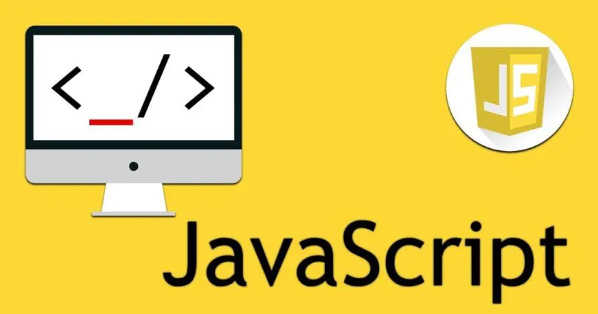
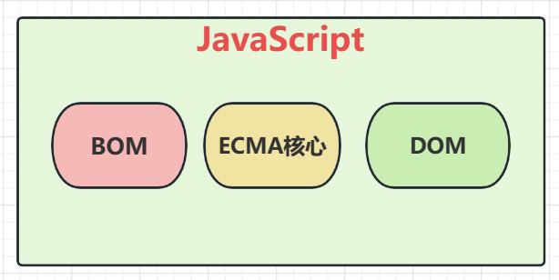
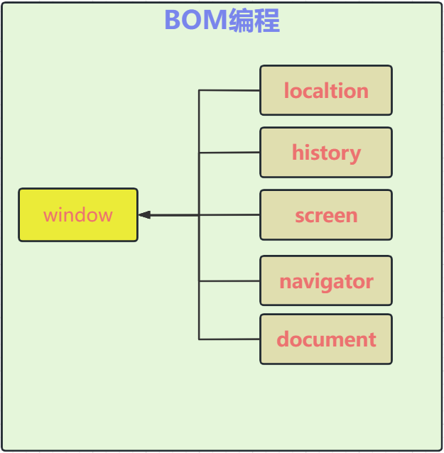
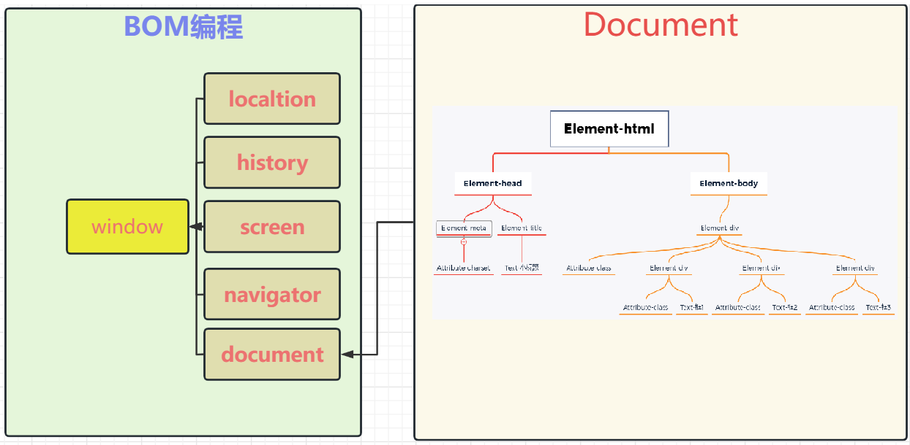

# 第三章 JavaScript

# 一 JS简介

## 1.1 JS起源

> Javascript是一种由Netscape(网景)的LiveScript发展而来的原型化继承的面向对象的动态类型的区分大小写的
`客户端脚本语言`，主要目的是为了解决服务器端语言，遗留的速度问题，为客户提供更流畅的浏览效果。当时服务端需要对数据进行验证，由于网络速度相当缓慢,只有28.8kbps，验证步骤浪费的时间太多。于是Netscape的浏览器Navigator加入了Javascript，提供了数据验证的基本功能。ECMA-262 是正式的 JavaScript 标准。这个标准基于 JavaScript (Netscape) 和 JScript (Microsoft)。ECMA-262 的开发始于 1996 年，在 1997 年 7 月，ECMA 会员大会采纳了它的首个版本。这个标准由 ECMA 组织发展和维护。JavaScript 的正式名称是 "ECMAScript"。JavaScript的组成包含ECMAScript、DOM、BOM。JS是一种运行于浏览器端上的小脚本语句,可以实现网页如文本内容、数据动态变化和动画特效等,JS有 如下特点

+ 脚本语言
    + JavaScript是一种解释型的脚本语言。不同于C、C++、Java等语言先编译后执行, JavaScript不会产生编译出来的字节码文件，而是在程序的运行过程中对源文件逐行进行解释。

+ 基于对象
    + JavaScript是一种基于对象的脚本语言，它不仅可以创建对象，也能使用现有的对象。但是面向对象的三大特性：『封装』、『继承』、『多态』中，JavaScript能够实现封装，可以模拟继承，不支持多态，所以它不是一门面向对象的编程语言。
+ 弱类型
    + JavaScript中也有明确的数据类型，但是声明一个变量后它可以接收任何类型的数据，并且会在程序执行过程中根据上下文自动转换类型。
+ 事件驱动
    + JavaScript是一种采用事件驱动的脚本语言，它不需要经过Web服务器就可以对用户的输入做出响应。
+ 跨平台性
    + JavaScript脚本语言不依赖于操作系统，仅需要浏览器的支持。因此一个JavaScript脚本在编写后可以带到任意机器上使用，前提是机器上的浏览器支持JavaScript脚本语言。目前JavaScript已被大多数的浏览器所支持。

## 1.2 JS 组成部分

> ECMA 及版本变化

+ 是一种由欧洲计算机制造商协会（ECMA）通过ECMA-262标准化的脚本程序语言,ECMAScript描述了语法、类型、语句、关键字、保留字、运算符和对象。它就是定义了脚本语言的所有属性、方法和对象。

+ ECMA-262第1版本质上跟网景的JavaScript 1.1相同，删除了浏览器特定代码和少量细微的修改.ECMA-262要求支持Unicode标准（以支持多语言）且对象要与平台无关
+ ECMA-262第2版只是做了一些编校工作，主要是为了严格符合ISO/IEC-16262的要求，并没有增减或改变任何特性。

+ ECMA-262第3版第一次真正对ECMAScript进行更新，更新了字符串处理、错误定义和数值输出，增加了对正则表达式、新的控制语句、try/catch异常处理的支持。
+ ECMA-262第4版是对这门语言的一次彻底修订。开发者开始修订ECMAScript以满足全球Web开发日益增长的需求。 第4版包括强类型变量、新语句和数据结构、真正的类和经典的继承，以及操作数据的新手段。
+ ECMA-262第5版是ECMA-262第3版的小幅改进，于2009年12月3日正式发布。第5版致力于厘清第3版存在的歧义，也增加了新功能。新功能包括原生的解析和序列化JSON数据的JSON对象、方便继承和高级属性定义的方法、新的增强ECMAScript引擎解释和执行代码能力的严格模式。
+ ECMA-262第6版俗称ES6、ES2015或ES Harmony（和谐版），于2015年6月发布。**
  `这一版包含了大概这个规范有史以来最重要的一批增强特性。`**ES6正式支持了类、模块、迭代器、生成器、箭头函数、期约、反射、代理和众多新的数据类型。但是并不是所有的浏览器都全面支持了ES6,很多情况下我们需要将ES6的语法通过工具转换成5以后运行
+ ECMA-262第7版也称为ES7或ES2016，于2016年6月发布。这次修订只包含少量语法层面的增强，如Array.prototype.includes和指数操作符。
+ ECMA-262第8版也称为ES8、ES2017，完成于2017年6月。这一版主要增加了异步函数（async/await）、SharedArrayBuffer及Atomics API、Object.values()/Object.entries()/Object.getOwnProperty- Descriptors()和字符串填充方法，另外明确支持对象字面量最后的逗号。
+ ECMA-262第9版也称为ES9、ES2018，发布于2018年6月。这次修订包括异步迭代、剩余和扩展属性、一组新的正则表达式特性、Promise finally()以及模板字面量修订。
+ ECMA-262第10版也称为ES10、ES2019，发布于2019年6月。这次修订增加了Array.prototype.flat()/flatMap()、String.prototype.trimStart()/trimEnd()、Object.fromEntries()方法以及Symbol.prototype.description属性，明确定义了Function.prototype.toString()的返回值并固定了Array.prototype.sort()的顺序。另外，这次修订解决了与JSON字符串兼容的问题，并定义了catch子句的可选绑定。
+ ECMA-262第11版，也成为ES11、ES2020，发布于2020年6月。这次修订增加了String 的 matchAll 方法、动态导入语句 import()、import.meta、export * as ns from 'module'、Promise.allSettled、GlobalThis、Nullish coalescing Operator、Optional Chaining以及一种新的数据类型BigInt，在此之后JavaScript正式迎来第8位数据类型。

> BOM编程

+ BOM是Browser Object Model的简写，即浏览器对象模型。

+ BOM有一系列对象组成，是访问、控制、修改浏览器的属性和方法

+ BOM没有统一的标准(每种客户端都可以自定标准)。

+ BOM编程是将浏览器窗口的各个组成部分抽象成各个对象,通过各个对象的API操作组件行为的一种编程

+ BOM编程的对象结构如下

    + window 顶级对象,代表整个浏览器窗口
        + location对象 window对象的属性之一,代表浏览器的地址栏
        + history对象 window对象的属性之一,代表浏览器的访问历史
        + screen对象 window对象的属性之一,代表屏幕
        + navigator对象 window对象的属性之一,代表浏览器软件本身
        + document对象 window对象的属性之一,代表浏览器窗口目前解析的html文档

    

> DOM编程

+ 简单来说:DOM编程就是使用document对象的API完成对网页HTML文档进行动态修改,以实现网页数据和样式动态变化效果的编程.
+ document对象代表整个html文档，可用来访问页面中的所有元素，是最复杂的一个dom对象，可以说是学习好dom编程的关键所在。
+ 根据HTML代码结构特点,document对象本身是一种树形结构的文档对象。

+ 上面的代码生成的树如下

+ DOM编程其实就是用window对象的document属性的相关API完成对页面元素的控制的编程

## 1.3 JS的引入方式

> 内部脚本方式引入
>
> 外部脚本方式引入

**代码示例**

- HTML 示例：[js-inclusion-methods.html](../src/main/java/com/example/phase3/js-inclusion-methods.html)
- JavaScript 示例：[button.js](../src/main/java/com/example/phase3/js/button.js)

# 二 JS的数据类型和运算符

## 2.1 JS的数据类型

## 2.2 JS的变量

代码示例：[js-variables-and-data-types.html](../src/main/java/com/example/phase3/js-variables-and-data-types.html)

## 2.3 JS的运算符

代码示例：[js-operators.html](../src/main/java/com/example/phase3/js-operators.html)

# 三 JS的流程控制和函数

## 3.1 JS分支结构

代码示例：[js-branching-structure.html](../src/main/java/com/example/phase3/js-branching-structure.html)

## 3.2 JS循环结构

代码示例：[js-loop-structures.html](../src/main/java/com/example/phase3/js-loop-structures.html)

## 3.3 JS函数声明

代码示例：[js-functions.html](../src/main/java/com/example/phase3/js-functions.html)
