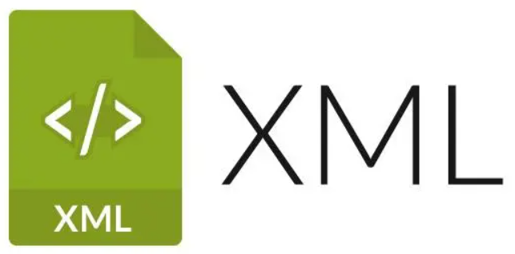

# 第四章 XML_Tomcat10_HTTP

# 一 XML



> XML是EXtensible Markup Language的缩写，翻译过来就是可扩展标记语言。所以很明显，XML和HTML一样都是标记语言，也就是说它们的基本语法都是标签。

+ **可扩展** 三个字表面上的意思是XML允许自定义格式。但这不代表你可以随便写。

+ 在XML基本语法规范的基础上，你使用的那些第三方应用程序、框架会通过XML约束的方式强制规定配置文件中可以写什么和怎么写

+ XML基本语法这个知识点的定位是：我们不需要从零开始，从头到尾的一行一行编写XML文档，而是在第三方应用程序、框架已提供的配置文件的基础上修改。要改成什么样取决于你的需求，而怎么改取决XML基本语法和具体的XML约束。

## 1.1 常见配置文件类型

1. properties文件,例如druid连接池就是使用properties文件作为配置文件
2. XML文件,例如Tomcat就是使用XML文件作为配置文件
3. YAML文件,例如SpringBoot就是使用YAML作为配置文件
4. json文件,通常用来做文件传输，也可以用来做前端或者移动端的配置文件
5. 等等...

### 1.1.1 properties配置文件

配置文件示例：[jdbc.properties](../src/main/resources/jdbc.properties)

> 语法规范

- 由键值对组成
- 键和值之间的符号是等号
- 每一行都必须顶格写，前面不能有空格之类的其他符号

### 1.1.2 xml配置文件

配置文件示例：[jdbc.xml](../src/main/resources/jdbc.xml)

> XML的基本语法

+ XML的基本语法和HTML的基本语法简直如出一辙。其实这不是偶然的，XML基本语法+HTML约束=HTML语法。在逻辑上HTML确实是XML的子集。

- XML文档声明 这部分基本上就是固定格式，要注意的是文档声明一定要从第一行第一列开始写

```xml
<?xml version="1.0" encoding="UTF-8"?>
```

- 根标签
    - &#x20;根标签有且只能有一个。
- 标签关闭
    - 双标签：开始标签和结束标签必须成对出现。
    - 单标签：单标签在标签内关闭。
- 标签嵌套
    - 可以嵌套，但是不能交叉嵌套。
- 注释不能嵌套
- 标签名、属性名建议使用小写字母
- 属性
    - 属性必须有值
    - 属性值必须加引号，单双都行

> XML的约束(稍微了解)

将来我们主要就是根据XML约束中的规定来编写XML配置文件，而且会在我们编写XML的时候根据约束来提示我们编写, 而XML约束主要包括DTD和Schema两种。

- DTD
- Schema

Schema约束要求我们一个XML文档中，所有标签，所有属性都必须在约束中有明确的定义。

下面我们以web.xml的约束声明为例来做个说明：

```xml

<web-app xmlns="http://xmlns.jcp.org/xml/ns/javaee"
         xmlns:xsi="http://www.w3.org/2001/XMLSchema-instance"
         xsi:schemaLocation="http://xmlns.jcp.org/xml/ns/javaee http://xmlns.jcp.org/xml/ns/javaee/web-app_4_0.xsd"
         version="4.0">
```

## 1.2 DOM4J进行XML解析

### 1.2.1 DOM4J的使用步骤

1. 导入jar包 dom4j.jar
2. 创建解析器对象(SAXReader)
3. 解析xml 获得Document对象
4. 获取根节点RootElement
5. 获取根节点下的子节点

### 1.2.2 DOM4J的API介绍

代码示例：[TestDom4j.java](../src/test/java/com/example/phase4/TestDom4j.java)
