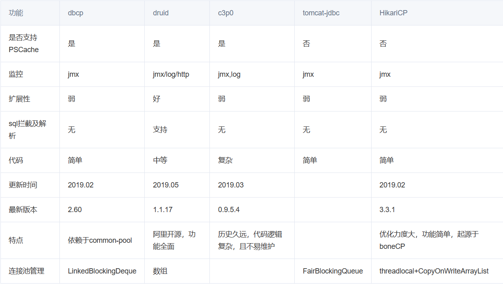
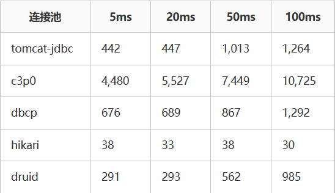
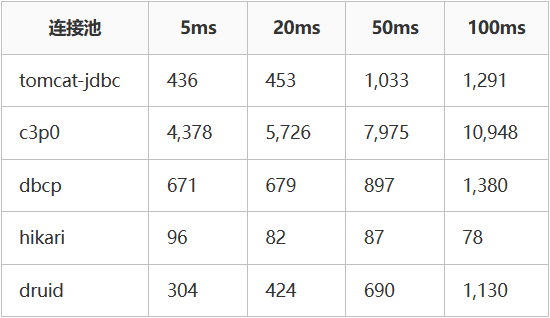

## 进阶篇

### 七、JDBC扩展

#### 7.1 实体类和ORM

> - 在使用JDBC操作数据库时，我们会发现数据都是零散的，明明在数据库中是一行完整的数据，到了Java中变成了一个一个的变量，不利于维护和管理。而我们Java是面向对象的，一个表对应的是一个类，一行数据就对应的是Java中的一个对象，一个列对应的是对象的属性，所以我们要把数据存储在一个载体里，这个载体就是实体类！
> - 实体类示例：[Employee.java](jdbc-demo/src/main/java/com/example/advanced/pojo/Employee.java)
> - ORM（Object Relational Mapping）思想，【对象到关系数据库的映射】，作用是在编程中，把面向对象的概念跟数据库中表的概念对应起来，以面向对象的角度操作数据库中的数据，即一张表对应一个类，一行数据对应一个对象，一个列对应一个属性！
> - 当下JDBC中这种过程我们称其为手动ORM。后续我们也会学习ORM框架，比如MyBatis、JPA等。
> - 封装代码：手动 ORM 映射示例：[testOrm()和testOrmList()](jdbc-demo/src/test/java/com/example/advanced/testJdbcAdvanced.java)

#### 7.2 主键回显

- 在数据中，执行新增操作时，主键列为自动增长，可以在表中直观的看到，但是在Java程序中，我们执行完新增后，只能得到受影响行数，无法得知当前新增数据的主键值。在Java程序中获取数据库中插入新数据后的主键值，并赋值给Java对象，此操作为主键回显。

- 代码实现：[testReturnPK()](jdbc-demo/src/test/java/com/example/advanced/testJdbcAdvanced.java)

#### 7.3 批量操作

- 插入多条数据时，一条一条发送给数据库执行，效率低下！

- 通过批量操作，可以提升多次操作效率！

- 代码实现：
-
    - 普通插入：[testMoresInsert()](jdbc-demo/src/test/java/com/example/advanced/testJdbcAdvanced.java)
-
    - 批量插入：[testBatch()](jdbc-demo/src/test/java/com/example/advanced/testJdbcAdvanced.java)

### 八、连接池

#### 8.1 现有问题

> - 每次操作数据库都要获取新连接，使用完毕后就close释放，频繁的创建和销毁造成资源浪费。
> - 连接的数量无法把控，对服务器来说压力巨大。

#### 8.2 连接池

> 连接池就是数据库连接对象的缓冲区，通过配置，由连接池负责创建连接、管理连接、释放连接等操作。
>
> 预先创建数据库连接放入连接池，用户在请求时，通过池直接获取连接，使用完毕后，将连接放回池中，避免了频繁的创建和销毁，同时解决了创建的效率。
>
> 当池中无连接可用，且未达到上限时，连接池会新建连接。
>
> 池中连接达到上限，用户请求会等待，可以设置超时时间。

#### 8.3 常见连接池

JDBC 的数据库连接池使用 javax.sql.DataSource接口进行规范，所有的第三方连接池都实现此接口，自行添加具体实现！也就是说，所有连接池获取连接的和回收连接方法都一样，不同的只有性能和扩展功能!

- DBCP 是Apache提供的数据库连接池，速度相对C3P0较快，但自身存在一些BUG。
- C3P0 是一个开源组织提供的一个数据库连接池，速度相对较慢，稳定性还可以。
- Proxool 是sourceforge下的一个开源项目数据库连接池，有监控连接池状态的功能， 稳定性较c3p0差一点
- **Druid 是阿里提供的数据库连接池，是集DBCP 、C3P0 、Proxool 优点于一身的数据库连接池，性能、扩展性、易用性都更好，功能丰富**。
- **Hikari（ひかり 光），是SpringBoot2.x之后内置的一款连接池，基于 BoneCP
  （已经放弃维护，推荐该连接池）做了不少的改进和优化，口号是快速、简单、可靠。**

|                             主流连接池的功能对比                              |
|:-------------------------------------------------------------------:|
|  |

|                           mock性能数据（单位：ms）                           |
|:-------------------------------------------------------------------:|
|  |

|                          mysql性能数据 (单位：ms)                          |
|:-------------------------------------------------------------------:|
|  |
