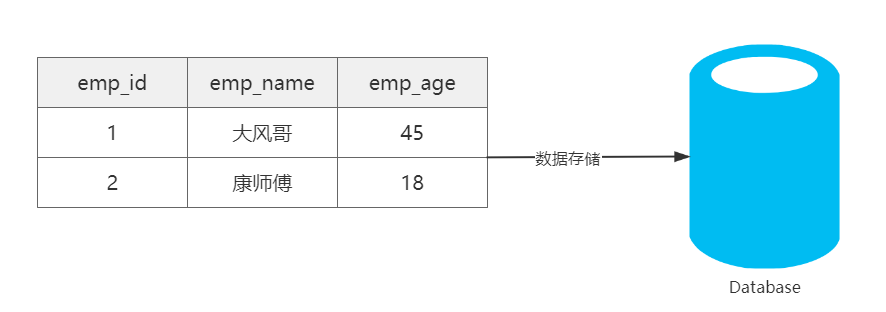
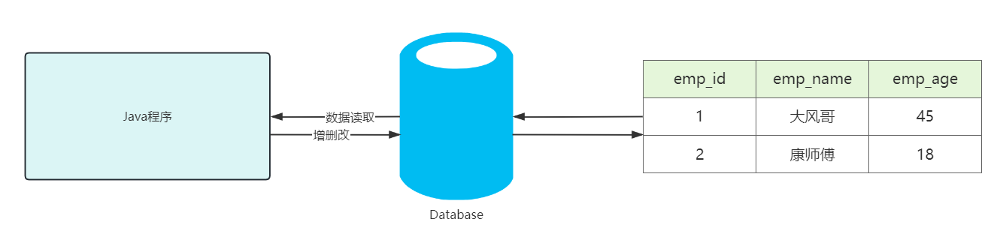
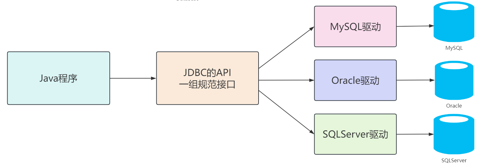

# JDBC数据库连接技术

## 基础篇

### 一、引言

#### 1.1 数据的存储

> 我们在开发Java程序时，数据都是存储在内存中，属于临时存储，当程序停止或重启时，内存中的数据就丢失了！我们为了解决数据的长期存储问题，有如下解决方案：
>
> 1. 数据通过I/O流技术，存储在本地磁盘中，解决了持久化问题，但是没有结构和逻辑，不方便管理和维护。
> 2. 通过关系型数据库，将数据按照特定的格式交由数据库管理系统维护。关系型数据库是通过库和表分隔不同的数据，表中数据存储的方式是行和列，区分相同格式不同值的数据。

|                               数据库存储数据                               |
|:-------------------------------------------------------------------:|
|  |

#### 1.2 数据的操作

> 数据存储在数据库，仅仅解决了我们数据存储的问题，但当我们程序运行时，需要读取数据，以及对数据做增删改的操作，那么我们如何通过Java程序对数据库中的数据做增删改查呢？

|                             Java程序读取数据库                             |
|:-------------------------------------------------------------------:|
|  |

### 二、JDBC

#### 2.1 JDBC的概念

> - JDBC：Java Database Connectivity，意为Java数据库连接。
> - JDBC是Java提供的一组独立于任何数据库管理系统的API。
> - Java提供接口规范，由各个数据库厂商提供接口的实现，厂商提供的实现类封装成jar文件，也就是我们俗称的数据库驱动jar包。
> - 学习JDBC，充分体现了面向接口编程的好处，程序员只关心标准和规范，而无需关注实现过程。

|                             JDBC简单执行过程                              |
|:-------------------------------------------------------------------:|
|  |

#### 2.2 JDBC的核心组成

- 接口规范：
    - 为了项目代码的可移植性，可维护性，SUN公司从最初就制定了Java程序连接各种数据库的统一接口规范。这样的话，不管是连接哪一种DBMS软件，Java代码可以保持一致性。
    - 接口存储在java.sql和javax.sql包下。
    - 官方文档：[Java SE 17 - java.sql 模块](https://docs.oracle.com/en/java/javase/17/docs/api/java.sql/module-summary.html)
- 实现规范：
    - 因为各个数据库厂商的DBMS软件各有不同，那么各自的内部如何通过SQL实现增、删、改、查等操作管理数据，只有这个数据库厂商自己更清楚，因此把接口规范的实现交给各个数据库厂商自己实现。
    - 厂商将实现内容和过程封装成jar文件，我们程序员只需要将jar文件引入到项目中集成即可，就可以开发调用实现过程操作数据库了。

### 三、JDBC快速入门

#### 3.1 JDBC搭建步骤

1. 准备 MySQL 数据库，确保数据库服务正常运行。
2. 在 IDEA 中创建 Java Maven 项目 `jdbc-demo`，配置 JDK 21。
3. 在项目的 `pom.xml` 中添加 MySQL Connector/J 驱动依赖：

- GroupId：`com.mysql`
- ArtifactId：`mysql-connector-j`
- Version：`26.10.0`

4. 重新加载 Maven 项目，由 Maven 自动下载并管理 JDBC 驱动，无需手动下载 JAR 文件、创建 `lib` 文件夹或执行 `Add as Library`。
5. 初始化数据库，编写并运行 JDBC 代码。

#### 3.2 代码实现

##### 3.2.1 数据库

数据库初始化脚本：[init.sql](./init.sql)

通过 IDEA 的 Database 工具执行 SQL 脚本，创建 `atguigu` 数据库、`t_emp` 表并插入初始数据。

##### 3.2.2 Java代码

[查看 JdbcQuick.java 源代码](./jdbc-demo/src/main/java/com/example/base/JdbcQuick.java)

#### 3.3 步骤总结

1. 注册驱动【依赖的驱动类，进行安装】
2. 获取连接【Connection建立连接】
3. 创建发送SQL语句对象【Connection创建发送SQL语句的Statement】
4. 发送SQL语句，并获取返回结果【Statement 发送sql语句到数据库并且取得返回结果】
5. 结果集解析【结果集解析，将查询结果解析出来】
6. 资源关闭【释放ResultSet、Statement 、Connection】
