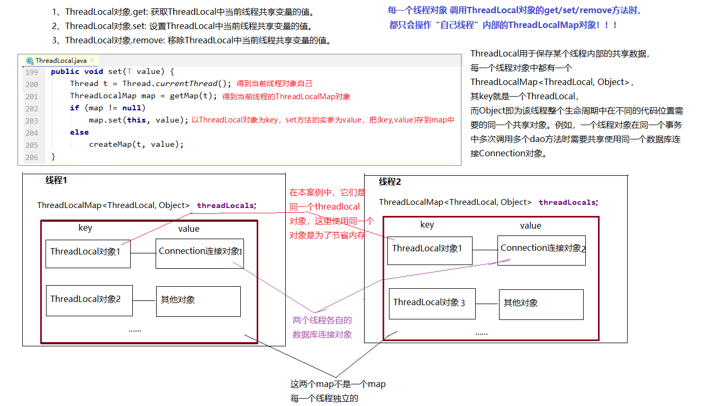

## 高级篇

### 九、JDBC优化及工具类封装

#### 9.1 现有问题

> 我们在使用JDBC的过程中，发现部分代码存在冗余的问题：
>
> - 创建连接池。
> - 获取连接。
> - 连接的回收。

#### 9.2 JDBC工具类封装V1.0

- 配置文件：[db.properties](jdbc-demo/src/main/resources/db.properties)
- 工具类代码：[JdbcUtil.java](jdbc-demo/src/main/java/com/example/senior/util/JdbcUtil.java)
- 测试代码：[JdbcUtilTest.java【testGetConnection()】](jdbc-demo/src/test/java/com/example/senior/JdbcUtilTest.java)
- 注意：此种封装方式，无法保证单个请求线程多次操作数据库时使用同一个连接，因此无法保证事务！

#### 9.3 ThreadLocal

> JDK 1.2的版本中就提供java.lang.ThreadLocal，为解决多线程程序的并发问题提供了一种新的思路。使用这个工具类可以很简洁地编写出优美的多线程程序。通常用来在在多线程中管理共享数据库连接、Session等。
>
> ThreadLocal用于保存某个线程共享变量，原因是在Java中，每一个线程对象中都有一个ThreadLocalMap<ThreadLocal， Object>，其key就是一个ThreadLocal，而Object即为该线程的共享变量。
>
> 而这个map是通过ThreadLocal的set和get方法操作的。对于同一个static ThreadLocal，不同线程只能从中get，set，remove自己的变量，而不会影响其他线程的变量。
>
> - 在进行对象跨层传递的时候，使用ThreadLocal可以避免多次传递，打破层次间的约束。
> - 线程间数据隔离。
> - 进行事务操作，用于存储线程事务信息。
> - 数据库连接，`Session`会话管理。
>
> 1、ThreadLocal对象.get: 获取ThreadLocal中当前线程共享变量的值。
>
> 2、ThreadLocal对象.set: 设置ThreadLocal中当前线程共享变量的值。
>
> 3、ThreadLocal对象.remove: 移除ThreadLocal中当前线程共享变量的值。

#### 9.4 JDBC工具类封装V2.0

> 在V1.0的版本基础上，我们将连接对象放在每个线程的ThreadLocal中，保证从头到尾当前线程操作的是同一连接对象。

- 工具类代码：[JdbcUtilV2.java](jdbc-demo/src/main/java/com/example/senior/util/JdbcUtilV2.java)
- 测试代码：[JdbcUtilTest.java【testJdbcV2()】](jdbc-demo/src/test/java/com/example/senior/JdbcUtilTest.java)

### 十、DAO封装及BaseDAO工具类

#### 10.1 DAO概念

> DAO：Data Access Object，数据访问对象。
>
> Java是面向对象语言，数据在Java中通常以对象的形式存在。一张表对应一个实体类，一张表的操作对应一个DAO对象！
>
> 在Java操作数据库时，我们会将对同一张表的增删改查操作统一维护起来，维护的这个类就是DAO层。
>
> DAO层只关注对数据库的操作，供业务层Service调用，将职责划分清楚！

#### 10.2 BaseDAO概念

> 基本上每一个数据表都应该有一个对应的DAO接口及其实现类，发现对所有表的操作（增、删、改、查）代码重复度很高，所以可以抽取公共代码，给这些DAO的实现类可以抽取一个公共的父类，复用增删改查的基本操作，我们称为BaseDAO。

#### 10.3 BaseDAO搭建

- BaseDAO代码：[BaseDao.java](jdbc-demo/src/main/java/com/example/senior/dao/BaseDao.java)

#### 10.4 BaseDAO的应用

##### 10.4.1 创建员工DAO接口

- DAO接口：[EmployeeDao.java](jdbc-demo/src/main/java/com/example/senior/dao/EmployeeDao.java)

##### 10.4.2 创建员工DAO接口实现类

- DAO实现类：[EmployeeDaoImpl.java](jdbc-demo/src/main/java/com/example/senior/dao/impl/EmployeeDaoImpl.java)
- 实体类：[Employee.java](jdbc-demo/src/main/java/com/example/senior/pojo/Employee.java)

##### 10.4.3 DAO测试

- 测试代码：[JdbcUtilTest.java【testEmployeeDao()】](jdbc-demo/src/test/java/com/example/senior/JdbcUtilTest.java)