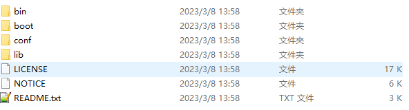

## Maven安装和配置

### 1. Maven安装

**软件结构：**

**bin**：含有Maven的运行脚本

boot：含有plexus-classworlds类加载器框架

**conf**：含有Maven的核心配置文件

lib：含有Maven运行时所需要的Java类库

LICENSE、NOTICE、README.txt：针对Maven版本，第三方软件等简要介绍

### 2. IDEA配置本地Maven软件

> 我们需要将配置好的maven软件，配置到idea开发工具中即可！
>
> 注意：idea工具默认自带maven配置软件，但是因为没有修改配置，建议替换成本地配置好的maven！

1、如果本地仓库地址不变化，只有一个原因，就是maven/conf/settings.xml配置文件编写错误！仔细检查即可！

2、一定保证User settings file对应之前修改的settings.xml的路径，若 不一致，选中Override复选框，手动选择配置文件
