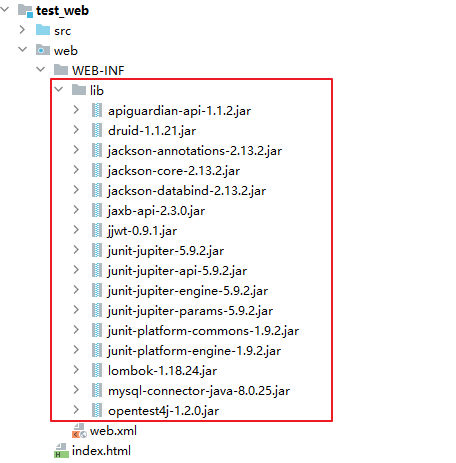
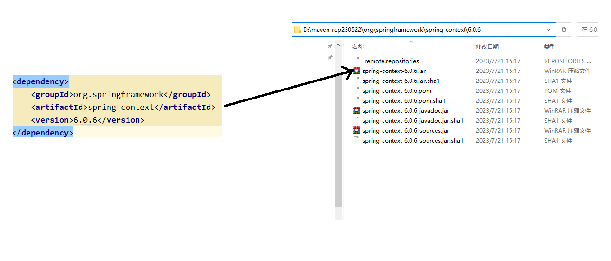
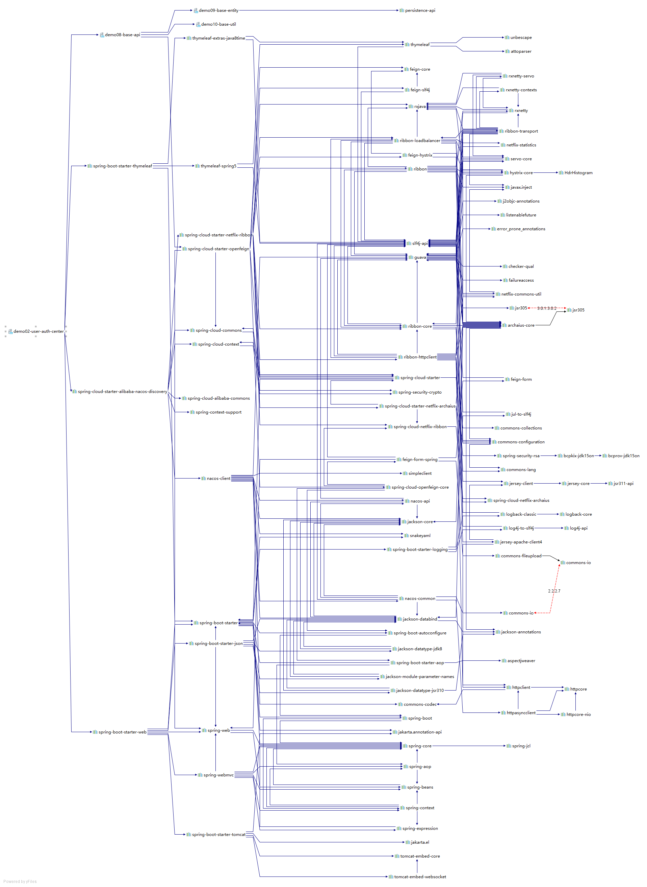
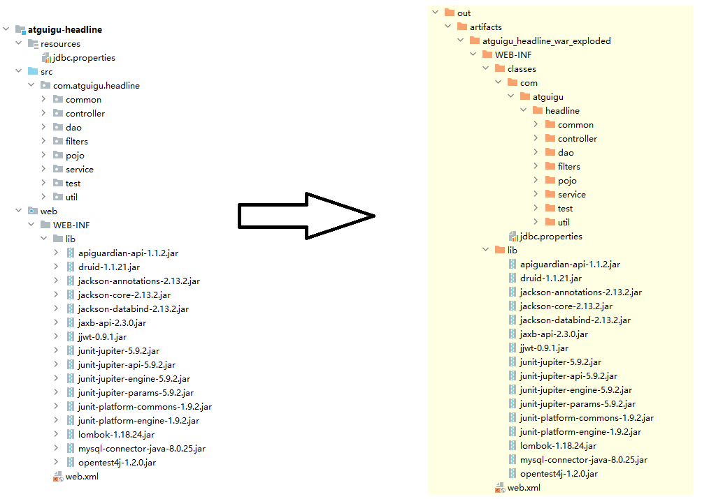
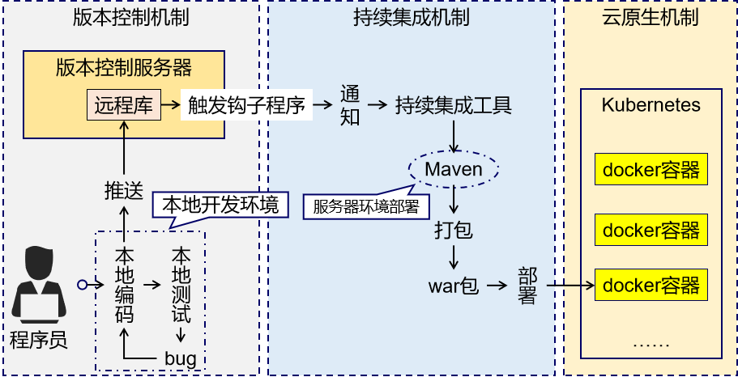
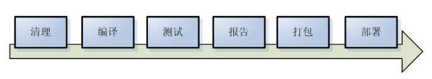
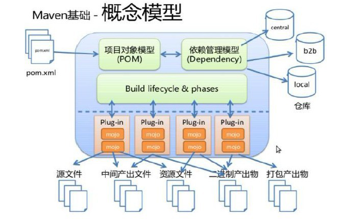

## Maven简介

### 1、为什么学习Maven

#### 1.1、Maven是一个依赖管理工具

①jar 包的规模

比如下面的例子，我们只用到 SpringBoot、SpringCloud 框架中的三个功能：

- Nacos 服务注册发现
- Web 框架环境
- 视图模板技术 Thymeleaf

最终却导入了 106 个 jar 包，

而如果使用 Maven 来引入这些 jar 包只需要配置三个『**依赖**』：

```xml
<!-- Nacos 服务注册发现启动器 -->
<dependency>
    <groupId>com.alibaba.cloud</groupId>
    <artifactId>spring-cloud-starter-alibaba-nacos-discovery</artifactId>
</dependency>

        <!-- web启动器依赖 -->
<dependency>
<groupId>org.springframework.boot</groupId>
<artifactId>spring-boot-starter-web</artifactId>
</dependency>

        <!-- 视图模板技术 thymeleaf -->
<dependency>
<groupId>org.springframework.boot</groupId>
<artifactId>spring-boot-starter-thymeleaf</artifactId>
</dependency>
```

②jar包的来源问题

- 这个jar包所属技术的官网。官网通常是英文界面，网站的结构又不尽相同，甚至找到下载链接还发现需要通过特殊的工具下载。
- 第三方网站提供下载。问题是不规范，在使用过程中会出现各种问题。
    - jar包的名称
    - jar包的版本
    - jar包内的具体细节
- 而使用 Maven 后，依赖对应的 jar 包能够**自动下载**，方便、快捷又规范。

③jar包的导入问题

在web工程中，jar包必须存放在指定位置：



在使用Maven之后，通过配置依赖(jar包)的坐标，查找本地仓库中相应jar包，若本地仓库没有，则统一从镜像网站或中央仓库中下载：



④jar包之间的依赖

框架中使用的 jar 包，不仅数量庞大，而且彼此之间存在错综复杂的依赖关系。依赖关系的复杂程度，已经上升到了完全不能靠人力手动解决的程度。另外，jar
包之间有可能产生冲突。进一步增加了我们在 jar 包使用过程中的难度。

下面是前面例子中 jar 包之间的依赖关系：



而实际上 jar 包之间的依赖关系是普遍存在的，如果要由程序员手动梳理无疑会增加极高的学习成本，而这些工作又对实现业务功能毫无帮助。

而使用 Maven 则几乎不需要管理这些关系，极个别的地方调整一下即可，极大的减轻了我们的工作量。

#### 1.2、Maven是一个构建工具

①你没有注意过的构建

你可以不使用 Maven，但是构建必须要做。当我们使用 IDEA 进行开发时，构建是 IDEA 替我们做的。



②脱离 IDE 环境仍需构建



#### 1.3、结论

- **管理规模庞大的 jar 包，需要专门工具。**
- **脱离 IDE 环境执行构建操作，需要专门工具。**

### 2. Maven介绍

<https://maven.apache.org/what-is-maven.html>

Maven 是一款为 Java 项目管理构建、依赖管理的工具（软件），使用 Maven 可以自动化构建、测试、打包和发布项目，大大提高了开发效率和质量。

Maven就是一个软件，掌握安装、配置、以及基本功能 **（项目构建、依赖管理）** 的理解和使用即可！

1. **依赖管理：**

   Maven 可以管理项目的依赖，包括自动下载所需依赖库、自动下载依赖需要的依赖并且保证版本没有冲突、依赖版本管理等。通过
   Maven，我们可以方便地维护项目所依赖的外部库，避免版本冲突和转换错误等，而我们仅仅需要编写配置即可。


2. **构建管理：**

   项目构建是指将源代码、配置文件、资源文件等转化为能够运行或部署的应用程序或库的过程

   Maven 可以管理项目的编译、测试、打包、部署等构建过程。通过实现标准的构建生命周期，Maven 可以确保每一个构建过程都遵循同样的规则和最佳实践。同时，Maven
   的插件机制也使得开发者可以对构建过程进行扩展和定制。主动触发构建，只需要简单的命令操作即可。

   

**场景1：** 例如我们项目需要第三方依赖如：Druid连接池、MySQL数据库驱动和Jackson
JSON等处理。那么我们可以将想要的依赖项的信息编写到Maven工程的配置文件，Maven就会自动下载并复制这些依赖项到项目中，无需自己导入jar包，管理jar!

**场景2：** 项目完成开发，我们想要打成war部署到服务器中，使用maven的构建命令可以快速打包！节省大量时间！

### 3. Maven软件工作原理模型图（了解）


