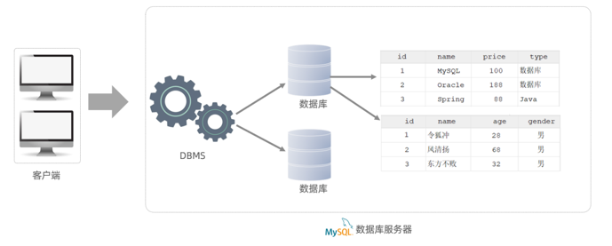

# MySQL 概述

## 1. macOS 上的常用命令

适用环境：通过 Homebrew 安装 MySQL 8.4，软件包名称为 `mysql@8.4`。

下面的命令在 **macOS 终端** 中执行，不是 SQL 语句，不需要在末尾添加分号。根据需要执行其中一条即可。

### 1.1 管理 MySQL 服务

| 操作                  | 命令                                |
|---------------------|-----------------------------------|
| 启动 MySQL 服务         | `brew services start mysql@8.4`   |
| 停止 MySQL 服务         | `brew services stop mysql@8.4`    |
| 查看 Homebrew 管理的服务状态 | `brew services list`              |
| 重启 MySQL 服务         | `brew services restart mysql@8.4` |
| 通过 MySQL 启动脚本检查服务状态 | `mysql.server status`             |

### 1.2 登录 MySQL

如果 `root` 账户当前允许无密码登录：

```bash
mysql -u root
```

如果已经设置了密码：

```bash
mysql -u root -p
```

执行第二条命令后，根据提示输入密码。`-u` 用于指定用户名，`-p` 表示提示输入密码。

登录成功后会出现 `mysql>` 提示符，此时才是在 MySQL 客户端中输入 SQL。

在 `mysql>` 后输入以下命令，可以退出客户端：

```text
exit
```

退出客户端不会停止 MySQL 服务。

客户端是操作入口，服务负责执行请求，两者是不同的程序。

## 2. DB、DBMS 与 SQL

| 名称            | 英文                         | 含义                           |
|---------------|----------------------------|------------------------------|
| 数据库（DB）       | Database                   | 有组织地存储和管理的数据集合，可以理解为存放数据的仓库。 |
| 数据库管理系统（DBMS） | Database Management System | 用于创建、管理和操作数据库的软件。            |
| SQL           | Structured Query Language  | 结构化查询语言，定义了一套操作关系型数据库的统一标准。  |

## 3. 关系型数据库与 RDBMS

关系型数据库建立在关系模型基础上，用表组织数据。表由行和列组成：

- **行（记录）**：表示一条具体的数据。
- **列（字段）**：表示数据的某一种属性，例如编号、姓名、年龄。
- 不同表可以通过相关字段建立联系，并通过查询组合数据。

**RDBMS** 的完整名称是 **Relational Database Management System**，意思是“关系型数据库管理系统”。MySQL、Oracle
Database、Db2、SQL Server 都属于这一类。

主要特点：

1. 使用表组织数据，同一张表的记录遵循定义好的列结构。
2. 可以使用 SQL 查询和操作数据。
3. 可以建立表之间的联系，组织有关联的数据。

## 4. MySQL 的数据模型

### 4.1 课程结构图

MySQL 是关系型数据库，基于二维表进行数据存储，结构如下：



以用户表为例，`id`、`name`、`age`、`gender` 是列；`1 / 令狐冲 / 28 / 男` 这一整行是一条记录。

### 4.2 用文字理解这张图

客户端负责发送请求，MySQL 服务负责执行 SQL 并返回结果。IDEA 的数据库工具、DataGrip 和 `mysql` 命令行程序都可以作为客户端。

这两张示例表用于说明数据库可以包含多张表，不表示它们的 `id` 列存在关联。不能仅凭列名相同就认定两张表有关联。

```text
客户端（IDEA 数据库工具 / DataGrip / mysql 命令行）
    │
    │ 发送 SQL，请求操作数据；接收执行结果
    ▼
MySQL 服务（数据库管理系统，DBMS）
    ├── 数据库 A
    │   ├── 课程表：多行课程记录，每行包含编号、名称、价格等列
    │   └── 用户表：多行用户记录，每行包含编号、姓名、年龄等列
    └── 数据库 B
        └── 其他数据表
```

可以这样记忆：

- 一个 MySQL 服务可以管理多个数据库。
- 一个数据库可以包含多张表。
- 一张表定义了若干列，并可以保存多行记录。
- 客户端通过 MySQL 服务操作数据库，SQL 可以操作表结构及表中的数据。

## 5. Markdown 注释

Markdown 支持使用 HTML 注释语法隐藏内容。

注释不会显示在 Markdown 预览页面中，但仍然保存在 `.md` 文件里。

<!-- 这是一行注释 -->

<!--
这是多行注释。
可以记录暂时不想在预览中显示的内容。
-->
